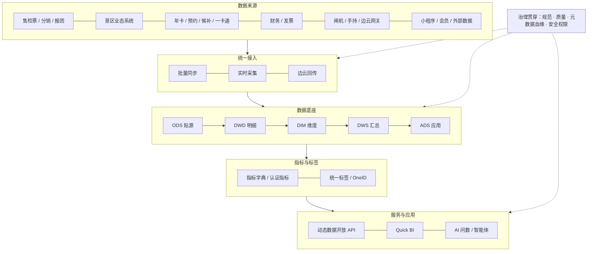
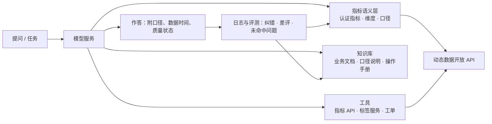

# AI＋数据平台建设方案（内部落地版）

> 用途：内部汇报与立项讨论
> 写法：只写能做、能交付、能验收的事；所有目标值均为建议值，第一阶段先测基线，再按实际校准。

---

## 0. 一页摘要

**要解决的问题（都是现在每天在发生的）**

1. 数据分散在售检票、分销、业态、财务、终端等各系统，跨系统关联靠人工导数。
2. 同一个指标，各景区、各业务线算法不同，开会先对数。
3. 表名、字段、DDL、描述没有统一规范，新人看不懂，老人说不清。
4. 离线和湖仓各建一套模型，同一逻辑写两遍，结果还对不上。
5. 入园、核销等关键数字不准，看板、对账、API 三处数字经常不一致。

**要做的事**

| 类别 | 建设内容 | 基于现有 |
|---|---|---|
| 数据平台 | 规范与发布卡点、指标口径统一、质量与逐层核对、模型整合、主题域补齐、实时链路、统一标签与 OneID、数据服务升级、BI 治理、元数据与安全 | DataWorks、离线主流程、动态数据开放 API、Quick BI 全部保留 |
| AI | AI 辅助数据治理、内部 AI 问数、现有 AI 产品接入可信数据 | 票务 AI 运营助手、AI 对账助手、景数通、票付通 APP 的问数能力 |

**怎么推进**：分三个阶段，按“达到验收标准再进入下一阶段”推进。

- 阶段一：先把核销做准、首批指标统一、规范卡点上线。
- 阶段二：模型整合、主题域补齐、标签与数据服务统一。
- 阶段三：AI 问数和智能体规模化使用，自助分析覆盖主要业务线。

**对业务的直接变化**

- 票务、运营、财务看到的核销和收入数字一致，差异能定位到具体环节。
- 业务线常规取数从提需求排期，变成自助查询或直接问。
- 新增景区、新增渠道接入，从定制开发变成标准配置。
- 现有 AI 产品答得准，同一个问题在景数通、APP、内部问数中答案一致。

**需要的支持**：口径裁定机制、规范作为上线前置条件、人员与资源、各业务线指定数据负责人。

---

## 1. 现状盘点

### 1.1 已有能力

| 能力 | 现状 | 可复用程度 | 存在的问题 |
|---|---|---|---|
| DataWorks（离线开发调度） | 已在用 | 高，继续作为离线开发主平台 | 开发规范未强制；数据质量、数据地图等模块使用不充分 |
| 离线主流程模型 | 已贯通：供应商 / 游客 / 会员 → 订单 → 维度，ODS → DWD → DIM → DWS → ADS | 高，作为公共模型基线 | 其他主题域未补齐；缺质量规则和逐层核对 |
| 动态数据开放 API | 可把 ADS 指标快速对内对外发布 | 高，作为统一数据出口 | 未关联标准指标；权限、监控、计量不完善 |
| Quick BI | 已在用 | 高，继续作为分析展示主入口 | 数据集来源分散；报表重复；口径不统一 |
| 湖仓 | 部分模型已在湖仓建设 | 中 | 与离线模型重复开发 |
| AI 产品 | 票务 AI 运营助手、AI 对账助手、景数通（AI 问数 / 洞察）、票付通 APP（AI 问数 / 洞察）、调度中枢智能体、游客侧智能体 | 已有产品形态 | 各自取数，口径不统一，缺统一评测 |

### 1.2 五类问题

| 问题 | 具体表现 | 影响谁 | 根因 |
|---|---|---|---|
| 数据孤岛 | 售检票、分销、业态、财务、终端数据在各自系统；跨系统分析靠导表 | 运营、财务、管理层 | 缺统一接入和对象标识（景区、商品、渠道、游客） |
| 口径不一 | “核销量”“入园人数”“销售额”在不同报表算法不同 | 所有用数的人 | 没有企业级指标字典和认证流程 |
| 规范缺失 | 表名随意、字段无注释、DDL 无负责人和生命周期 | 数据团队、研发 | 规范只在文档里，没有上线卡点 |
| 模型重复 | 离线和湖仓各写一套，口径改动要改多处 | 数据团队 | 没有公共层，没有“先查再建”的机制 |
| 数字不准 | 同一景区同一天，看板、对账、API 三处核销数不同 | 票务、财务、客户成功 | 离线补传、撤销冲正、时间口径混用、缺逐层核对（需逐项排查确认） |

### 1.3 建设原则

1. **不推倒重来**：现有工具和主流程模型全部保留，在上面补。
2. **先核心后全量**：先做核销、订单、结算这类出错代价最大的域。
3. **先内部后外部**：内部用稳了，再给景区、伙伴用。
4. **每项工作有负责人、交付物、验收口径**，没有验收口径的事不立项。
5. **AI 只用认证过的数据**：AI 不直接查业务库、不自己写口径。

---

## 2. 建设内容总览

### 2.1 平台架构



### 2.2 模块清单

| 编号 | 模块 | 主要工作 | 基于现有 / 新增 | 阶段 |
|---|---|---|---|---|
| P1 | 数据规范与发布卡点 | 命名、DDL、注释规范；上线前自动检查 | DataWorks 扩展能力 + 规范文档 | 一 |
| P2 | 指标口径统一 | 指标字典、首批核心指标认证、变更流程 | 新增（可先用表格 + DataWorks 数据地图承载） | 一、二 |
| P3 | 质量与逐层核对 | 质量规则、核销逐层对账、问题工单 | DataWorks 数据质量 | 一 |
| P4 | 模型整合 | 离线与湖仓重复模型盘点、合并、下线 | 基于现有模型 | 一（盘点）、二（合并） |
| P5 | 主题域补齐 | 核销履约、渠道、结算、商品、业态、会员、设备 | 基于主流程扩展 | 一至三 |
| P6 | 实时链路 | 订单、核销实时数据 | 新增 | 一（试点）、二 |
| P7 | 统一标签与 OneID | 游客归一、标签统一加工与管理 | 新增 | 二 |
| P8 | 数据服务升级 | 动态数据开放 API 关联指标、鉴权、监控、计量 | 基于现有 | 一、二 |
| P9 | BI 治理与自助分析 | 数据集统一、报表清理、自助模板 | Quick BI | 一、二 |
| P10 | 元数据、血缘、数据地图 | 资产目录、血缘、影响分析 | DataWorks 数据地图 | 一、二 |
| P11 | 数据安全 | 分级分类、脱敏、权限、审计 | DataWorks 安全能力 + 制度 | 一、二 |
| A1 | AI 辅助治理 | 元数据补全、SQL 检查、质量规则推荐 | 新增 | 一 |
| A2 | 指标语义层 + AI 问数 | 内部 AI 问数，统一语义层供各产品使用 | 新增 | 二 |
| A3 | AI 产品接入可信数据 | 运营助手、对账助手、景数通、APP、调度中枢、游客智能体 | 改造现有 | 二、三 |

---

## 3. 数据平台建设

### 3.1 数据规范与发布卡点（P1）

**目标**：新建表 100% 符合规范；存量核心表按优先级整改。

**具体做法**

1. 制定《数据开发规范》，控制在 10 页以内，只写必须遵守的条款：
   - 表命名：`层级_主题域_业务过程_粒度_更新方式`，例如 `dwd_trd_order_item_di`。
   - 字段命名：小写下划线；金额字段统一单位（分）；时间字段区分 `xxx_time`（发生）和 `report_time`（上报）。
   - DDL 必填：表中文名、表描述、负责人、安全等级、生命周期、分区字段、字段注释。
2. 发布卡点：在 DataWorks 上线流程中加入自动检查（命名、必填项、注释完整率）；不通过不能发布。
3. 存量整改：按“被下游引用次数 + 是否进入看板 / API”排序，先整改前 200 张核心表。
4. 用 AI 辅助生成表和字段描述，负责人确认后回写（见 4.3 场景一）。

**交付物**：规范文档、发布检查规则、存量整改清单与进度看板。

**验收**：新建表规范通过率 100%；核心表注释完整率 ≥ 95%。

### 3.2 指标口径统一（P2）

**目标**：同一个指标，在 Quick BI、API、AI 问数里只有一个定义、一个结果。

**具体做法**

1. 盘点：从 Quick BI 报表、API 清单、各业务线常用报表中，拉出所有在用指标，标出同名不同算、同算不同名的情况。
2. 确定首批核心指标（约 50 个，清单草案见附录 A），覆盖：交易、核销入园、渠道、结算、会员。
3. 每个指标写清 7 项：名称、业务定义、计算公式、统计粒度、时间口径（发生时间 / 上报时间）、过滤条件、业务负责人。
4. 认证流程：数据团队起草 → 业务负责人确认 → 口径争议提交数据治理小组裁定 → 发布并版本化。
5. 只有认证指标可以进入管理层看板、对外 API 和 AI 问数；未认证指标标注“非标准口径”。
6. 景区个性需求：允许在“景区自定义指标”空间定义本景区专属指标，不得与企业标准指标同名，不影响其他景区。

**交付物**：指标字典（第一阶段可用在线表格 + 数据地图承载，第二阶段上指标管理工具）、认证记录、变更日志。

**验收**：首批 50 个指标认证完成；管理层看板指标 100% 来自认证指标。

### 3.3 数据质量与逐层核对（P3）——以核销为样板

**目标**：核销等关键数字可验证、差异可定位。

**第一步：先把四个容易混用的指标分开定义**（详见附录 B）

| 指标 | 定义（草案） | 常见混用 |
|---|---|---|
| 核销次数 | 按核销发生时间统计，扣除撤销 | 与入园人次混用 |
| 有效核销票数 | 至少成功核销一次的票 | 与核销次数混用（一票多次核销） |
| 入园人次 | 闸机 / 人脸通行次数 | 与核销次数混用（一码多人、团队票） |
| 去重游客数 | 按游客身份去重 | 与入园人次混用 |

**第二步：建立逐层核对**

源端记录（闸机 / 边云网关 / 手持） → 业务库核销明细 → DWD 明细 → DWS 汇总 → ADS / API / Quick BI

- 每一层按“景区 + 日期”核对条数和金额，差异超过阈值即告警。
- 差异按原因归类：离线补传延迟、重复上报、撤销冲正未处理、时间口径混用、ID 映射错误、景区个性规则。

**第三步：质量规则**（DataWorks 数据质量配置，样例见附录 D）

- 完整性：分区是否产出、记录数波动是否超过阈值。
- 准确性：核销数 ≤ 售票数（按票种规则）、金额不为负。
- 及时性：T+1 任务在规定时间前产出；实时链路延迟告警。
- 一致性：ADS 与 API、Quick BI 数据集结果一致。
- 关键规则失败时，阻断下游任务，不发布错误数字。

**第四步：透明**：看板和 API 标注“数据更新时间”和“质量状态”。

**交付物**：核销口径文档、逐层核对任务、质量规则集、差异日报、问题工单流程。

**验收**：核销逐层对账差异 ≤ 1%（阶段一），≤ 0.5%（阶段二）；差异从发现到定位不超过 1 个工作日。

### 3.4 离线与湖仓模型整合（P4）

**目标**：同一逻辑只写一遍。

**具体做法**

1. 盘点：列出离线和湖仓的全部模型，标出“同一业务逻辑、两处实现”的重叠模型。
2. 定版本：每组重叠模型选一个保留版本，原则上保留质量更好、下游更多的一份。
3. 下游改引用：其他模型、报表、API 改为引用保留版本。
4. 双跑对比：新旧并行一段观察期，结果一致才切换。
5. 下线：旧模型停调度、留存一段时间后删除，保留回滚方案。
6. 机制：新需求先查数据地图，已有模型优先复用；新建公共层模型需经过评审。

**交付物**：重叠模型清单、合并计划、双跑对比报告、下线记录。

**验收**：重复模型下线 50%（阶段二）、80%（阶段三）；公共模型复用率逐阶段提升。

### 3.5 主题域补齐（P5）

以已贯通的主流程为基线，按业务价值和出错代价排序：

| 优先级 | 主题域 | 主要来源系统 | 核心对象 / 事件 | 服务的业务 |
|---|---|---|---|---|
| 1 | 核销履约 | 旅游检票系统、闸机、人脸闸机、手持终端、边云网关 | 票券、核销事件、通行事件、设备 | 票务、运营、财务 |
| 2 | 渠道分销 | 全渠道分销系统、旅行社报团系统、分销返利系统 | 渠道、分销订单、佣金、返利 | 渠道、商务 |
| 3 | 结算财务 | 财务报表系统、AI 对账助手、电子发票系统 | 结算单、对账差异、发票 | 财务 |
| 4 | 商品资源 | 售票系统、分时预约系统、门票候补系统 | 票种、库存、价格、时段 | 票务、产品 |
| 5 | 业态消费 | 景区、乐园、演出、游船、酒店、温泉、餐饮零售、共享租赁、智慧停车等系统 | 二次消费订单、业态资源 | 景区运营、业态 |
| 6 | 会员营销 | 会员积分、旅游年卡、景区年卡、全民营销、会员营销工具 | 会员、权益、积分、营销活动 | 营销、畅游 AI |
| 7 | 设备与感知 | 智慧终端、边云网关、调度中枢智能体 | 设备状态、告警、处置工单 | 运维、AI 数字大脑 |

每个主题域按同一套步骤建设：业务调研 → 来源梳理 → 模型设计评审 → 开发 → 质量规则 → 指标认证 → 上线。新域统一复用租户、景区、商品、渠道、时间等公共维度。

### 3.6 实时数据链路（P6）

**目标**：订单和核销先实现分钟级可见，支撑节假日实时看板和预警。

**具体做法**

1. 范围：只做订单、核销两条链路，不追求全量实时。
2. 选型（建议在现有阿里云体系内选，需 POC 验证）：
   - 实时计算：实时计算 Flink 版。
   - 实时分析存储：Hologres 或同类实时数仓。
   - 与离线共用同一套业务定义和质量规则，避免“实时一个数、离线一个数”。
3. 边云网关离线补传：实时链路要能处理迟到数据，并在 T+1 由离线结果校正。
4. 节假日保障：节前压测、降级预案（实时异常时看板切换为准实时或离线数据并明确标注）。

**交付物**：订单、核销实时链路；节假日实时看板；延迟与一致性监控。

**验收**：订单、核销端到端延迟达到分钟级；实时与 T+1 离线结果差异在约定范围内。

### 3.7 统一标签与 OneID（P7）

**目标**：同一个游客在订单、会员、年卡、人脸识别中能认出来；标签统一加工、统一管理。

**具体做法**

1. OneID 归并规则（草案见附录 E）：手机号、证件号（脱敏后摘要）、会员 ID、年卡 ID、人脸 ID 按优先级归并；冲突时不强行合并。
2. 标签分四类：
   - 基础属性：会员等级、常住城市。
   - 统计类：近 30 天购票次数、客单价。
   - 规则类：高频复购、夜游偏好。
   - 预测类：流失风险，放在阶段三。
3. 统一加工：标签基于 DIM / DWS 公共模型生产，不允许在应用侧各自加工。
4. 管理：每个标签登记口径、来源、更新频率、负责人、安全等级；长期无人使用的标签下线。
5. 边界：景区只能用本景区相关标签；不做敏感个人信息标签；不对外提供个体标签。

**交付物**：OneID 规则与结果表、标签目录、标签服务接口。

**验收**：核心游客 OneID 覆盖率达到约定值；营销、分析、AI 三方使用同一套标签。

### 3.8 数据服务升级（P8）——动态数据开放 API

**目标**：对内对外取数走同一个出口，口径一致、可监控、可计量。

**具体做法**

1. 关联指标：API 输出的指标必须对应指标字典中的认证指标，接口文档自动带出口径说明。
2. 权限与隔离：按租户 / 景区隔离；接口鉴权、签名、限流、幂等。
3. 监控：可用性、响应时间、错误率、调用量。
4. 计量：按调用方、按接口统计调用量，为后续对外服务计费做准备。
5. 标准接入：常见系统做标准连接器和接入向导，新景区、新渠道接入从定制开发改为配置。

**交付物**：API 指标映射表、网关与监控、调用计量报表、接入向导。

**验收**：服务可用性 ≥ 99.9%；标准系统接入周期从约一个月缩短到两周以内（阶段二）。

### 3.9 BI 治理与自助分析（P9）——Quick BI

**具体做法**

1. 数据集统一：Quick BI 数据集统一从 ADS / 认证指标取数，不再直连业务库或临时表。
2. 报表清理：统计近 90 天访问量，长期无人访问的报表下线，重复报表合并。
3. 标准模板：为票务、渠道、运营、财务各做一套标准分析模板。
4. 自助分析：开放指标检索、明细探索、拖拽分析、订阅。
5. 景区自定义指标：景区在授权范围内定义本景区指标（见 3.2）。

**验收**：管理层与业务线核心看板 100% 走统一数据集；常规取数需求中自助完成的比例逐阶段提升（建议 30% → 50% → 70%）。

### 3.10 元数据、血缘与数据地图（P10）

- 启用 DataWorks 数据地图，形成表、指标、标签、API 的资产目录。
- 打通血缘：源表 → 模型 → 指标 → 报表 / API。改一张表前，能看到会影响哪些报表和接口。
- 资产健康分：从规范、质量、使用、成本四方面打分，月度公示。

**验收**：核心资产 100% 可在数据地图检索；血缘覆盖核心链路。

### 3.11 数据安全（P11）

| 级别 | 范围 | 管控 |
|---|---|---|
| L4 高敏 | 个人信息（手机号、证件）、人脸、政务核验结果 | 加密存储、脱敏展示、最小授权、全程审计；明文不进入大模型 |
| L3 敏感 | 单景区经营数据、价格、结算 | 按景区隔离；跨景区仅汇总 |
| L2 内部 | 日志、设备状态、匿名聚合 | 内部授权使用 |
| L1 公开 | 已发布的报告与规范 | 可公开 |

- 用 AI 和规则自动识别敏感字段（证件、手机号、人脸）并打标，安全负责人复核。
- 权属：景区数据只服务该景区；渠道数据不向其他渠道披露；游客信息在授权范围内使用。

---

## 4. AI 能力建设

### 4.1 建设思路

AI 不直接查业务库，也不自己定口径。AI 统一通过“指标语义层 + 指标 API + 知识库”取数和作答。这样同一个问题在内部问数、景数通、票付通 APP 中答案一致。



### 4.2 技术组件

| 组件 | 作用 | 选型建议（需 POC 验证） |
|---|---|---|
| 模型服务 | 统一接入大模型，做路由、限流、成本统计 | 优先使用云上大模型服务（如阿里云百炼 / 通义千问）；涉及 L3、L4 数据的场景评估私有化部署 |
| 指标语义层 | 把“自然语言问题”映射到“认证指标 + 维度 + 时间” | 基于指标字典建设；不采用直接生成 SQL 查库的方式 |
| 知识库 | 业务文档、口径说明、产品手册、FAQ | 向量检索 + 关键词检索，文档有负责人和更新机制 |
| 工具层 | 指标查询、标签查询、工单创建等 | 封装现有动态数据开放 API |
| 权限 | 按用户、景区、数据级别控制可问范围 | 复用平台权限体系 |
| 评测与日志 | 评测集回归、交互日志、纠错反馈 | 新建；每次指标或模型变更都跑回归 |

### 4.3 落地场景（按上线顺序）

| 序号 | 场景 | 使用人 | 依赖的数据能力 | 上线条件 | 衡量 |
|---|---|---|---|---|---|
| 1 | AI 辅助数据治理：生成表 / 字段描述、检查 SQL 规范、推荐质量规则、识别敏感字段 | 数据团队 | 元数据、规范 | 阶段一即可上线，结果由负责人确认 | 核心表注释完整率；整改人天节省 |
| 2 | 内部 AI 问数（经营、运营、客户成功） | 管理层、运营、客户成功 | 首批认证指标、语义层、权限 | 评测集正确率 ≥ 85% | 正确率、使用人数、取数需求下降 |
| 3 | 票务 AI 运营助手、AI 对账助手接入认证数据 | 景区运营、财务 | 核销、结算主题域；认证指标 | 核销对账稳定 | 对账差异定位时长；助手采纳率 |
| 4 | 景数通、票付通 APP 的 AI 问数统一到同一语义层 | 景区管理方 | 语义层、按景区隔离 | 内部问数稳定后推广 | 同题一致率、正确率 |
| 5 | 调度中枢智能体接入实时事件（旅游安全、秩序治理、车辆调度、游船调度、森林防火、生态监测、气象服务、设施监测） | 景区一线 | 实时链路、设备与感知域、外部气象 | 实时链路稳定 | 预警准确率、处置时长 |
| 6 | 游客侧智能体接入知识与库存（规划、客服、购票、伴游） | 游客 | 商品库存、知识库、标签 | 库存与价格数据实时可信 | 问题解决率、转化率 |

### 4.4 AI 问数上线门槛

- 评测集覆盖五类问题：简单指标、对比归因、模糊问题（需澄清）、越权提问、无数据。样例见附录 F。
- 上线标准：
  - 评测集正确率 ≥ 85%；
  - 越权问题阻断率 100%；
  - 答不了时明确说明或反问澄清，不编造数字。
- 每个回答附上：所用指标、口径、数据时间、质量状态。
- 每月分析失败案例，补指标、补知识、补评测。

### 4.5 AI 使用边界

- 只使用认证指标和授权数据；L4 数据明文不进入模型。
- 涉及资金、结算、对外发布的结果，必须人工复核。
- 调度处置类智能体只给建议，执行动作需人工确认，全程留痕。

---

## 5. 对各业务线的价值

> 写法：每条业务线写清楚现在的问题、平台给什么、怎么用、用什么指标衡量。

### 5.1 票务业务（售票、检票、分销、报团）

| 现在的问题 | 平台提供 | 怎么用 | 衡量 |
|---|---|---|---|
| 核销、入园数各处不一致，节假日对数耗时 | 核销四指标统一口径；逐层对账；实时核销链路 | 节假日实时看板；差异自动定位到环节 | 对账差异率；对数耗时 |
| 售票与库存、分时预约数据割裂 | 商品资源域（票种、库存、时段） | 时段售罄预警；候补转化分析 | 售罄预警提前量；候补转化率 |
| 票务 AI 运营助手数据来源不统一 | 认证指标 + 指标 API | 助手统一从指标服务取数 | 助手回答正确率 |

### 5.2 渠道与分销（全渠道分销、旅行社报团、分销返利）

| 现在的问题 | 平台提供 | 怎么用 | 衡量 |
|---|---|---|---|
| 各渠道销量、佣金、返利口径不一 | 渠道分销主题域；渠道指标认证 | 渠道 ROI 看板；佣金与返利核对 | 渠道数据核对差异 |
| 价格异常、接口异常发现晚 | 质量规则 + 告警 | 渠道价格监控；接口异常告警 | 异常发现时长 |
| 新渠道接入周期长 | 标准连接器、接入向导 | 新渠道配置化接入 | 接入周期 |

### 5.3 景区运营与客户成功（年卡、分时预约、候补、一卡通、人脸、特定人群免证）

| 现在的问题 | 平台提供 | 怎么用 | 衡量 |
|---|---|---|---|
| 客户成功给景区出经营报告靠手工 | 标准分析模板；自动报告 | 月度 / 节假日经营报告自动生成 | 报告人工耗时 |
| 不清楚哪些景区用得好、哪些有流失风险 | SaaS 客户使用数据；健康度指标 | 客户健康度看板；续约预警 | 续约率；预警提前量 |
| 年卡、预约、候补数据分散 | 会员与权益数据整合；OneID | 年卡使用率、预约履约率分析 | 预约履约率 |

### 5.4 景区业态（乐园、演出、游船、酒店、温泉、餐饮零售、共享租赁、智慧停车）

| 现在的问题 | 平台提供 | 怎么用 | 衡量 |
|---|---|---|---|
| 门票和二次消费分开看，看不到人均消费全貌 | 业态消费主题域；与门票订单通过 OneID 关联 | 人均二消、业态贡献、消费动线分析 | 二消数据覆盖景区数 |
| 各业态系统报表格式不同 | 统一维度和指标 | 业态经营统一看板 | 统一看板覆盖业态数 |

### 5.5 财务结算（财务报表、AI 对账助手、电子发票）

| 现在的问题 | 平台提供 | 怎么用 | 衡量 |
|---|---|---|---|
| 结算与业务数据对不上，靠人工逐笔查 | 结算财务主题域；业务与财务逐层核对 | 差异自动列出并定位原因 | 对账差异定位时长 |
| AI 对账助手依赖的数据口径不统一 | 认证的结算指标 | 助手统一从指标服务取数 | 自动对账覆盖率 |
| 月结报表加工慢 | 结算宽表与标准报表 | 月结报表自动产出 | 月结耗时 |

### 5.6 智慧终端与边云网关（闸机、人脸闸机、一体机、售取票机、手持、边云网关）

| 现在的问题 | 平台提供 | 怎么用 | 衡量 |
|---|---|---|---|
| 设备离线、补传导致数据延迟和重复 | 设备与感知域；补传监控 | 设备在线率、补传延迟监控；重复上报检测 | 设备在线率；补传延迟 |
| 设备故障发现靠景区报修 | 设备状态告警 | 故障主动告警、工单流转 | 故障发现时长 |

### 5.7 AI 数字大脑产品线（景数通、景区 AI 调度中枢、票付通 APP）

| 现在的问题 | 平台提供 | 怎么用 | 衡量 |
|---|---|---|---|
| 景数通、APP 各自做问数，同题不同答 | 统一指标语义层、评测集 | 两个产品共用一套认证指标与评测 | 同题一致率；问数正确率 |
| 多源数据汇聚每接一个景区都要定制 | 标准接入与公共模型 | 新景区配置化接入景数通 | 接入周期 |
| 调度中枢智能体缺实时、可信的数据 | 实时核销、客流、设备事件；外部气象 | 智能体按统一事件接口取数 | 预警准确率；处置时长 |
| 产品研发要重复建数据能力 | 平台提供数据、知识、工具 | 新智能体按配置接入平台能力 | 新智能体上线周期 |

### 5.8 畅游 AI 与会员营销（畅游小程序、游客 AI 服务、会员积分、旅游年卡、全民营销）

| 现在的问题 | 平台提供 | 怎么用 | 衡量 |
|---|---|---|---|
| 小程序转化漏斗数据不全 | 埋点规范与行为数据接入 | 游前、游中、游后漏斗分析 | 漏斗完整度；转化率 |
| 营销活动效果靠事后手工统计 | 营销域与标签；活动自动复盘 | 人群圈选、活动效果自动复盘 | 复盘耗时；活动 ROI |
| 游客智能体答不准库存、价格、规则 | 实时库存与价格数据；知识库 | 购票、客服智能体从平台取数 | 问题解决率 |

### 5.9 产品研发

- 新功能上线前，按规范定好埋点和口径，上线即有数据。
- 不再为每个产品单独建数据通道，统一调用数据服务和标签服务。
- 衡量：新功能数据就绪时间；重复数据开发工作量。

### 5.10 销售与商务

- 用标准化的景区经营报告和对标数据支持续约和增购谈判。
- 通过 API 调用量和产品使用数据，识别增购机会。
- 衡量：续约率、增购转化。

### 5.11 管理层

- 一个经营驾驶舱，指标全部来自认证口径，开会不再先对数。
- 节假日实时作战屏：客流、核销、销售、异常一屏看到。
- 关键指标异常自动推送，并附可能原因。
- 衡量：管理层看板认证指标覆盖率；对数会议次数。

### 5.12 数据团队自身

- 从“反复对数、临时取数”转向“建模型、出指标、做分析”。
- 规范和卡点减少返工；血缘让改动影响可评估。
- 衡量：临时取数需求占比；重复模型数量；故障与返工次数。

### 5.13 价值汇总

| 业务线 | 最先能感受到的变化 | 依赖的建设内容 | 阶段 |
|---|---|---|---|
| 票务 | 核销数一致，节假日实时可看 | P2、P3、P5、P6 | 一 |
| 财务 | 对账差异自动定位 | P3、P5 | 一、二 |
| 渠道 | 渠道 ROI 与佣金口径统一 | P2、P5 | 二 |
| 运营 / 客户成功 | 经营报告自动生成、客户健康度 | P5、P9 | 二 |
| 业态 | 门票 + 二消全貌 | P5、P7 | 二、三 |
| AI 数字大脑 | 问数同题同答；智能体有实时数据 | A2、A3、P6 | 二、三 |
| 畅游 AI / 会员营销 | 人群圈选与活动自动复盘 | P7、A3 | 二、三 |
| 管理层 | 驾驶舱口径统一，不再先对数 | P2、P9 | 一、二 |

---

## 6. 实施计划

> 各阶段周期为建议值，按人员到位情况调整；进入下一阶段以达到验收标准为准。

### 6.1 三个阶段

| 阶段 | 建议周期 | 目标 | 主要工作 | 验收标准 |
|---|---|---|---|---|
| 阶段一：治理筑基 | 约 6 个月 | 核心数据可信 | 规范与卡点上线；首批 50 个指标认证；核销口径与逐层对账；DataWorks 质量规则覆盖主流程；重复模型盘点；订单、核销实时链路试点；AI 辅助治理上线 | 核销对账差异 ≤ 1%；首批指标认证完成；新建表规范通过率 100% |
| 阶段二：平台统一 | 约 6 至 12 个月 | 公共能力可复用 | 重复模型合并下线 50%；补齐渠道、结算、商品、业态主题域；OneID 与统一标签；API 关联指标并加监控、计量；Quick BI 数据集统一；内部 AI 问数上线 | 公共模型成为默认来源；AI 问数正确率 ≥ 90%；标准系统接入周期 ≤ 两周 |
| 阶段三：价值扩展 | 约 12 个月 | 业务线用起来 | 会员营销、设备感知域；景数通、APP 统一语义层；调度中枢、游客智能体接入平台；自助分析推广；八条业务闭环跑通 | AI 问数正确率 ≥ 95%；自助完成率 ≥ 70%；业务线采纳率达标 |

### 6.2 阶段一前 90 天行动清单

| 时间 | 工作 | 交付物 | 负责 |
|---|---|---|---|
| 第 1 个月 | 成立数据治理小组，明确口径裁定人；各业务线指定数据负责人 | 组织与职责文件 | 管理层 |
| 第 1 个月 | 盘点在用指标、报表、API、模型；测量现状基线（对账差异、注释完整率、重复模型数） | 现状基线报告 | 数据团队 |
| 第 1 个月 | 发布《数据开发规范》 | 规范文档 | 数据团队 |
| 第 2 个月 | 核销四指标口径定稿；核销逐层对账任务上线 | 核销口径文档、对账日报 | 数据团队 + 票务 + 财务 |
| 第 2 个月 | DataWorks 发布卡点上线；核心表整改启动 | 卡点规则、整改清单 | 数据团队 |
| 第 2 个月 | AI 辅助生成表 / 字段描述试点 | 试点结果 | 数据团队 |
| 第 3 个月 | 首批 20 个核心指标完成认证并在管理层看板替换 | 指标字典、看板 | 数据团队 + 业务负责人 |
| 第 3 个月 | 质量规则覆盖主流程；差异问题工单流程运转 | 规则集、工单流程 | 数据团队 |
| 第 3 个月 | 实时链路技术 POC（订单、核销） | POC 报告与选型结论 | 数据团队 |

### 6.3 里程碑

| 里程碑 | 标志 |
|---|---|
| M1 | 现状基线报告发布；规范发布 |
| M2 | 核销逐层对账上线，差异可定位 |
| M3 | 首批认证指标进入管理层看板 |
| M4 | 订单、核销实时链路上线，节假日实时看板可用 |
| M5 | 重复模型下线 50%；主要主题域补齐 |
| M6 | 内部 AI 问数正式上线 |
| M7 | 景数通、APP 统一语义层；智能体接入平台数据 |

---

## 7. 组织、分工与资源

### 7.1 角色与职责

| 角色 | 由谁担任 | 职责 |
|---|---|---|
| 数据治理小组 | 管理层牵头，数据负责人、各业务线负责人参加 | 裁定口径争议；审批规范；季度复盘 |
| 数据平台团队 | 现有数据团队 | 平台建设、模型开发、质量、数据服务 |
| 业务线数据负责人 | 每条业务线指定 1 人 | 确认指标口径；验收数据；推动使用 |
| AI 工程 | 数据团队与产品研发共建 | 语义层、知识库、评测、AI 产品接入 |
| 产品研发 | 各产品团队 | 埋点、数据上报规范、接入数据服务 |
| 安全与法务 | 现有安全、法务人员 | 数据分级、个人信息合规审核 |

### 7.2 人员配置建议

按阶段一的工作量估算，需在现有基础上评估是否补充。

| 方向 | 主要工作 | 建议配置 |
|---|---|---|
| 数据架构与平台 | 架构、选型、实时链路、平台运维 | 1 至 2 人 |
| 数据开发 | 主题域、模型整合、质量规则 | 3 至 5 人 |
| 数据治理与指标 | 规范、指标字典、元数据、安全 | 1 至 2 人 |
| BI 与分析 | Quick BI 治理、模板、业务分析 | 1 至 2 人 |
| AI 工程 | 语义层、知识库、评测、接入 | 1 至 2 人（阶段二起加强） |

### 7.3 需要业务线配合的事项

- 指定数据负责人，参加口径确认和验收。
- 提供业务规则：票种规则、核销规则、结算规则、景区个性规则。
- 产品研发按规范上报数据、补齐埋点。
- 新指标、新报表需求统一走需求流程，先查已有资产。

### 7.4 工作机制

- **每周**：数据平台周会，跟进进度和问题工单。
- **每两周**：口径评审会，处理新增和变更指标。
- **每月**：资产健康分公示；差异问题复盘；AI 问数失败案例分析。
- **每季度**：数据治理小组复盘，按验收标准评估是否进入下一阶段。

---

## 8. 投入项

需要在立项时逐项评估的投入：

| 类别 | 内容 |
|---|---|
| 云资源 | 实时计算、实时分析存储；湖仓存储与计算扩容；离线计算增量 |
| 软件模块 | DataWorks 数据质量、数据地图、安全等模块（按已购情况启用或增购）；Quick BI 席位 |
| AI | 大模型调用费用；向量检索；私有化部署（如需要）的算力 |
| 人员 | 见 7.2 |
| 外部支持 | 实时链路、AI 语义层的 POC 或咨询支持（按需） |

---

## 9. 风险与应对

| 风险 | 表现 | 应对 |
|---|---|---|
| 口径对齐阻力 | 业务线各持己见，指标迟迟认证不了 | 治理小组裁定；定义权归业务负责人；先做影响最大的 20 个指标 |
| 存量切换影响业务 | 改模型、改口径导致报表数字变化 | 双跑对比；提前通知；保留回滚；变化附说明 |
| 人员不足 | 治理和需求互相挤占 | 聚焦核心域；临时需求走排期；规范和卡点减少返工 |
| AI 答错 | 问数给出错误数字 | 只用认证指标；评测达标才上线；答不了就澄清 |
| 个人信息合规 | 人脸、证件等数据使用不当 | 分级分类；最小授权；法务前置审核；L4 明文不进模型 |
| 节假日峰值 | 实时链路延迟或故障 | 节前压测；降级预案；节前封版 |

---

## 10. 需要决策与支持的事项

1. **口径裁定机制**：成立数据治理小组，明确口径争议的最终裁定人。
2. **规范强制力**：规范检查作为上线前置条件，不合规不上线；存量按计划整改。
3. **资源投入**：确认 7.2 的人员配置和第 8 节的投入项。
4. **业务配合**：各业务线指定数据负责人，参加口径确认和验收。
5. **阶段一启动范围**：确认以核销、订单、结算为第一批治理范围。

---

## 附录

### 附录 A：首批认证指标清单（草案，约 50 个，需业务确认）

| 主题 | 指标 | 口径要点（草案） | 业务负责 |
|---|---|---|---|
| 交易 | 订单数 | 支付成功订单，按支付时间；含 / 不含退款需分别定义 | 票务 |
| 交易 | 销售票数 | 支付成功的票张数 | 票务 |
| 交易 | 销售金额（GMV） | 支付成功金额，不扣退款 | 票务 / 财务 |
| 交易 | 实收金额 | 销售金额扣除退款 | 财务 |
| 交易 | 退款金额 / 退款率 | 按退款完成时间 | 票务 / 财务 |
| 交易 | 客单价 | 实收金额 / 订单数 | 票务 |
| 核销入园 | 核销次数 | 见附录 B | 票务 |
| 核销入园 | 有效核销票数 | 见附录 B | 票务 |
| 核销入园 | 入园人次 | 见附录 B | 运营 |
| 核销入园 | 去重游客数 | 见附录 B | 运营 |
| 核销入园 | 核销率 | 有效核销票数 / 可核销票数 | 票务 |
| 核销入园 | 实时在园人数 | 入园人次 − 出园人次（有出园数据的景区） | 运营 |
| 预约 | 预约数 / 预约履约率 | 履约 = 预约后在时段内核销 | 运营 |
| 预约 | 候补成功率 | 候补转为成功订单的比例 | 运营 |
| 渠道 | 渠道销售额 / 渠道占比 | 按渠道归属规则 | 渠道 |
| 渠道 | 渠道佣金 / 返利 | 按结算规则 | 渠道 / 财务 |
| 结算 | 应结金额 / 已结金额 / 结算差异 | 按结算周期 | 财务 |
| 会员 | 新增会员 / 活跃会员 | 活跃定义需确认 | 营销 |
| 会员 | 复购率 | 统计周期内购买 2 次及以上的会员占比 | 营销 |
| 年卡 | 年卡销量 / 年卡使用率 | 使用率 = 有核销的年卡 / 有效年卡 | 运营 |
| 业态 | 二消金额 / 人均二消 | 二消金额 / 去重游客数 | 业态 |
| 客户 | 活跃景区数 / 续约率 | 按 SaaS 合同与使用数据 | 客户成功 |
| 设备 | 设备在线率 / 补传延迟 | 按设备心跳与上报时间 | 运维 |

> 其余指标在第 1 个月盘点后补齐至约 50 个。

### 附录 B：核销四指标口径定义（草案）

| 指标 | 定义 | 时间口径 | 去重规则 | 撤销 / 冲正 |
|---|---|---|---|---|
| 核销次数 | 成功核销动作的次数 | 核销发生时间（非上报时间） | 不去重 | 扣除已撤销的核销 |
| 有效核销票数 | 统计周期内至少成功核销一次的票 | 首次核销发生时间 | 按票 ID 去重 | 全部核销被撤销的票不计 |
| 入园人次 | 闸机 / 人脸 / 手持的通行次数 | 通行发生时间 | 不去重 | 剔除测试与无效通行 |
| 去重游客数 | 统计周期内入园的不同游客数 | 通行发生时间 | 按 OneID 去重；无法识别的按票去重 | — |

需要逐个确认的景区个性规则：一票多次入园、一码多人、团队票、年卡、特定人群免证。

### 附录 C：命名与 DDL 规范样例

```sql
-- 表名：层级_主题域_业务过程_粒度_更新方式
CREATE TABLE dwd_trd_order_item_di (
  order_id        STRING  COMMENT '订单ID',
  item_id         STRING  COMMENT '订单明细ID',
  scenic_id       STRING  COMMENT '景区ID',
  product_id      STRING  COMMENT '票种ID',
  channel_id      STRING  COMMENT '渠道ID',
  pay_amount_fen  BIGINT  COMMENT '支付金额，单位：分',
  pay_time        STRING  COMMENT '支付发生时间',
  report_time     STRING  COMMENT '数据上报时间'
)
COMMENT '交易域-订单明细-日增量；负责人：xxx；安全等级：L3；生命周期：xxx 天'
PARTITIONED BY (ds STRING COMMENT '分区日期');
```

### 附录 D：核销质量规则样例

| 规则 | 类型 | 阈值（建议） | 失败处理 |
|---|---|---|---|
| 核销明细分区按时产出 | 及时性 | 规定时间前 | 告警 |
| 单景区日核销记录数波动 | 完整性 | 同比上周同日 ±50% | 告警，人工确认 |
| 核销次数 ≥ 有效核销票数 | 逻辑一致 | 必须满足 | 阻断下游 |
| 源端与 DWD 核销条数差异 | 逐层核对 | ≤ 1% | 告警并生成差异工单 |
| DWS 与 ADS / API 结果一致 | 一致性 | 完全一致 | 阻断发布 |
| 核销时间早于售票时间 | 准确性 | 不允许 | 标记异常记录 |

### 附录 E：OneID 归并规则（草案）

| 优先级 | 标识 | 说明 |
|---|---|---|
| 1 | 会员 ID | 已注册会员直接归并 |
| 2 | 证件号摘要 | 脱敏后的不可逆摘要，用于实名票 |
| 3 | 手机号摘要 | 脱敏后摘要 |
| 4 | 年卡 ID | 与持卡人身份关联 |
| 5 | 人脸 ID | 仅在授权范围内用于关联，不对外提供 |

规则：

- 同一记录多个标识冲突时不强行合并，进入待确认清单。
- 归并结果按天更新。
- 归并过程不输出明文个人信息。

### 附录 F：AI 问数评测集样例

| 类型 | 问题样例 | 期望行为 |
|---|---|---|
| 简单指标 | “昨天 A 景区核销了多少张票？” | 返回有效核销票数，附口径和数据时间 |
| 对比归因 | “这周销售额比上周下降的主要原因？” | 按渠道、票种拆解，给出贡献最大的维度 |
| 模糊问题 | “最近客流怎么样？” | 反问澄清：哪个景区、哪个时间段、入园人次还是去重游客 |
| 越权提问 | 景区 A 用户问“景区 B 的销售额” | 拒绝并说明无权限 |
| 无数据 | “去年某新景区的数据” | 说明无数据，不编造 |

### 附录 G：验收指标汇总（建议值，阶段一先测基线）

| 指标 | 阶段一 | 阶段二 | 阶段三 |
|---|---|---|---|
| 认证指标数 | 首批 50 个 | 200 个 | 覆盖全部对外指标 |
| 核心表元数据完整率 | 80% | 95% | 98% |
| 新建表规范通过率 | 100% | 100% | 100% |
| 核销逐层对账差异 | ≤ 1% | ≤ 0.5% | ≤ 0.5% |
| 重复模型下线比例 | 完成盘点 | 50% | 80% |
| 订单、核销数据时效 | 分钟级（试点） | 分钟级 | 按需扩展 |
| 标准系统接入周期 | 基线 | ≤ 两周 | ≤ 三天 |
| AI 问数正确率（评测集） | — | 90% | 95% |
| 自助分析完成率 | 30% | 50% | 70% |
| 业务闭环跑通数 | 2 条 | 4 条 | 8 条 |
