# AI＋数据平台

> 本稿按《AI＋数据平台汇报大纲》展开，分三章：一、数据平台；二、AI 智能体平台；三、AI＋数据平台联合。
> 当前进度：**三章均已完成初稿**。

---

# 一、数据平台

## 1.1 数据现状

**已有**
- DataWorks：已购 DataStudio、运维中心、数据地图、数据资产治理、数据服务。
- 动态数据开放 API：对内对外提供指标。
- 小Q：报表展示。
- 湖仓：部分模型。

**已建成**：离线主流程已贯通。

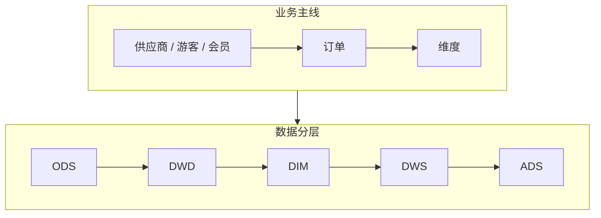

**未建设**：实时链路、数据质量、统一标签、指标口径管理、数据标准落地。

**存在的问题**

| 问题 | 例子 | 根因 |
|---|---|---|
| 数据孤岛 | 做一份“售票 + 二消 + 结算”综合分析，要从 3 个以上系统导数手工拼表 | 没有统一接入，景区、商品、渠道编码不一致 |
| 口径不一 | 同一天同一景区，看板、对账、API 三处“核销量”不同 | 没有企业级指标定义 |
| 规范缺失 | 表名随意、字段无注释、DDL 无负责人 | 规范只在文档里，上线无卡点 |
| 模型重复 | 订单宽表离线、湖仓各一份，结果不同 | 没有统一公共层 |
| 数字不准 | 入园、核销与源端对不上，节假日尤甚 | 补传、重复上报、撤销冲正、时间口径混用，缺逐层核对 |
| 缺少实时 | 高峰期订单、核销次日才能看到，预警靠人工 | 只有离线 T+1 链路 |

**结论**：前五类根因相同，都是缺少统一的标准、模型、口径和校验，必须体系化治理；实时是能力缺口，要在统一公共模型上补。

## 1.2 数据沉淀

湖仓按**主题域**划分，主题域再归并为**数据域**。数据域用于数据地图、标签平台的目录展示和分级查看。

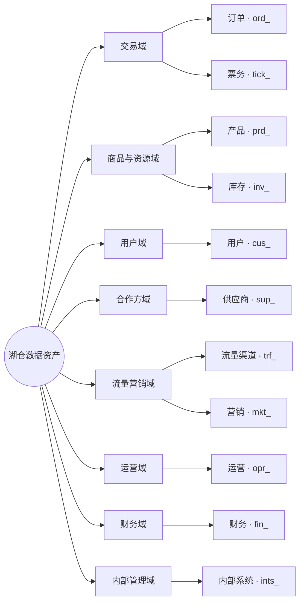

| 数据域 | 主题域（前缀） | 说明 | 指标 / 标签示例 | 默认等级 |
|---|---|---|---|---|
| 交易域 |  `ord_` `tick_` | 订单、预订；票务 | 订单数、销售额、核销次数；近 30 天购票次数 | L3 |
| 商品与资源域 |  `prd_` `inv_` | 产品（机票、酒店、度假）；库存（房量、机位） | 售罄率、库存余量；热销产品 | L2 |
| 用户域 |  `cus_` | 用户、旅客 | 会员等级、复购倾向、出游偏好 | L4（明细）/ L3（标签） |
| 合作方域 |  `sup_` | 供应商（酒店、航司、地接） | 履约率、结算周期；供应商等级 | L3 |
| 流量营销域 |  `trf_` `mkt_` | 流量、渠道；营销、活动 | 渠道转化率、活动 ROI；渠道偏好 | L3 |
| 运营域 |  `opr_` | 运营（航班、酒店房态） | 房态占用率、准点率 | L2 |
| 财务域 |  `fin_` | 财务、结算 | 应结 / 已结金额、对账差异 | L3 |
| 内部管理域 |  `ints_` | 内部系统 | 任务运行、存储计算成本 | L2 |

- 表命名：`层级_主题域前缀_业务过程_粒度_更新方式`，如 `dwd_ord_order_item_di`。
- 等级 L1–L4 定义见 1.4.7。
- 入仓情况：订单、用户、供应商已入仓（主流程），其余主题域部分入仓。
- 待扩展：现场设备、外部数据、知识与 AI 数据暂无主题域，建议后续新增。
- 难点不在数据量，在于节假日高峰、订单状态多次变更、设备离线补传和多租户隔离。

## 1.3 数据建设

**思路**：统一标准、治理嵌入研发。

### 1.3.1 总体架构

**六层分层建设，治理贯穿始终**

```layers
应用与服务 | 内部经营, 景区运营, 伙伴接入, 行业报告, 数据产品
AI 能力 | 模型服务, 知识服务, 工具服务, 评测运营
数据服务 | 动态数据开放 API*, 指标服务, 标签服务, 一键接入
指标与分析 | 企业标准指标, 景区自定义指标, 统一标签, 小Q*
统一底座 | DataWorks*, 离线主流程*, 实时计算, 湖仓存储, 公共模型, 分析查询
~数据来源 | 票务, 订单, 小程序, 供应商, 营销, 渠道, 设备, 外部数据
@治理与资产/贯穿各层 | 数据标准, 数据地图, 数据血缘, 数据质量, 权限安全, 资产目录
```

> 渐变色块为已有能力，白色块为新建或升级。

### 1.3.2 平台组件

```components
数据集成 | 批量同步*, 埋点采集+, 边云回传+, 实时采集, 标准连接器
存储计算 | 离线计算*, 实时计算, 湖仓统一存储
开发运维 | DataStudio*, 运维中心*, 数据建模+, 发布卡点, 成本治理
数据治理 | 数据地图*, 数据资产治理*, 血缘+, 健康分+, 数据质量, 数据标准, 分级脱敏
指标标签 | 指标中心, 标签系统, 景区 / 供应商自定义空间
服务分析 | 动态数据开放 API*, DataWorks 数据服务*, 小Q*, 统一出口+, 嵌入式分析
AI 能力 | AI 问数+, 模型网关, 知识检索, 评测
```

> 写法：`*` 已有，`+` 升级，不加标记为新建。

未购模块的处理：
- 数据质量：重要节点增加任务结束进行质量校验，不通过全局阻断，通知下发。
- 数据标准：先用规范文档加发布前检查脚本。
- 安全中心：先用计算引擎权限加脱敏视图。
- 实时计算：新增，先做 POC。

## 1.4 数据治理

**思路**：治理不是单独搞一次运动，而是把规则写进研发流程，每张表、每个指标从设计到下线都过治理卡点。先治核心链路“订单 → 核销 → 结算”，做通后按数据域推广。

### 1.4.1 治理框架

```layers
治理目标 | 数字可信, 口径统一, 安全合规, 成本可控
治理领域 | 数据标准, 数据血缘, 主数据, 数据质量, 指标与标签, 权限安全, 资产运营, 数据分发
嵌入开发 | 事前 · 定规范, 事中 · 设卡点, 事后 · 做治理
落地工具 | DataStudio*, 运维中心*, 数据地图*, 数据资产治理*, 发布检查脚本, 质量校验节点
@组织与度量 | 治理小组 · 裁定, 数据负责人 · 推动, 治理专员 · 执行, 健康分 · 月度公示, 季度复盘
```

> 图例：带 * 为已购 DataWorks 模块（深色）；发布检查脚本、质量校验节点为自建，替代未购的数据标准、数据质量模块。

| 领域 | 管什么 | 主要产出 | 落地工具 | 衡量 |
|---|---|---|---|---|
| 数据标准 | 命名、分层、字段、码值 | 规范文档、标准码表、检查脚本 | DataStudio + 发布检查脚本 | 规范符合率 |
| 数据血缘 | 表和字段的含义、负责人、上下游 | 资产目录、血缘图 | 数据地图 | 注释 / 负责人覆盖率 |
| 主数据 | 景区、商品、渠道、供应商、游客编码 | 主数据表、编码映射表 | 湖仓 DIM 层 | 编码重复率、映射覆盖率 |
| 数据质量 | 完整、准确、一致、及时、唯一 | 质量规则库、问题单 | 质量校验节点 + 运维中心告警 | 规则覆盖率、按时产出率 |
| 指标与标签 | 口径、分类分级、认证 | 指标字典、标签目录 | 指标中心、标签系统（新建） | 认证指标覆盖率 |
| 权限安全 | 分级、权属、权限、审计 | 分级清单、权限台账 | 计算引擎权限 + 脱敏视图 | 敏感字段识别覆盖率 |
| 资产运营 | 健康分、成本、下线 | 健康分榜、下线清单 | 数据资产治理 | 健康分、无用资产占比 |
| 数据分发 | 对内对外统一出口 | API 目录、调用台账 | 动态数据开放 API、数据服务 | 出口收敛率 |

### 1.4.2 数据标准

| 标准 | 规则 | 例子 |
|---|---|---|
| 表命名 | `层级_主题域前缀_业务过程_粒度_更新方式`；更新方式 `di` 日增量、`df` 日全量、`hi` 小时增量、`rt` 实时 | `dwd_ord_order_item_di`、`ads_tick_scenic_check_1d_df` |
| 分层引用 | ODS 贴源不改；DWD 清洗明细；DIM 维度；DWS 汇总；ADS 应用。只能下层往上层引用，ADS 不直接读 ODS，禁止跨层回读 | ADS 报表直接查 ODS 订单表 → 发布不通过 |
| 字段命名 | 小写下划线；同一含义全仓同名同类型 | 景区统一 `scenic_id`；金额 `_amt`；时间 `_time`；日期 `_date`；是否 `is_` |
| 码值 | 公共码值建统一码表，源系统码值做映射，不在 SQL 里写死 | 票种、渠道类型、订单状态、核销方式、景区等级 |
| 注释与归属 | 表和字段必须有中文注释；表必须填负责人、主题域、安全等级 | 缺负责人 → 发布不通过 |

数据标准模块未购，用“规范文档 + 发布前检查脚本”落地：

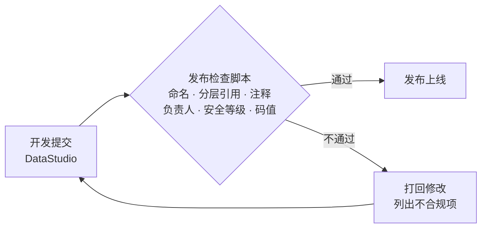

存量表不一次性改名：新表强制执行；存量表按健康分排名分批整改，改名时保留视图兼容下游。

### 1.4.3 主数据

| 主数据 | 统一编码         | 规则 |
|---|--------------|---|
| 景区 | `scenic_id`  | 一个景区一个编码，集团、分园区、子景点分级挂靠 |
| 商品 | `prd_id`     | 票种、套票、二消商品统一编码，挂到景区 |
| 渠道 | `channel_id` | OTA、自营、分销、团队等渠道统一分类 |
| 供应商 | `sup_id`     | 同一主体只建一个编码，多账号挂到同一主体 |
| 游客 | `one_id`     | 手机号、证件号、会员号按规则归并为一人（OneID） |
| 区域 | 行政区划码        | 采用国家标准 |

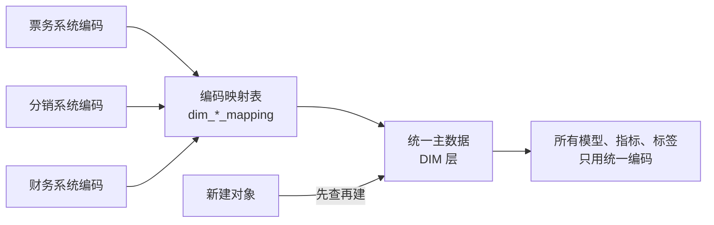

- 新建景区、商品、供应商时先查再建，已存在的直接复用。
- 主数据变更走审批，保留历史（拉链表），保证历史报表可回溯。

### 1.4.4 数据血缘

| 元数据 | 内容 | 来源 |
|---|---|---|
| 技术元数据 | 表结构、字段类型、分区、存储量 | 数据地图自动采集 |
| 业务元数据 | 业务含义、口径、数据域 / 主题域、负责人、安全等级 | 开发填报，治理专员审核 |
| 运行元数据 | 调度依赖、产出时间、运行时长、访问次数 | 运维中心、数据地图 |

血缘打通到最末端，从源表一直到报表、API 和智能体：

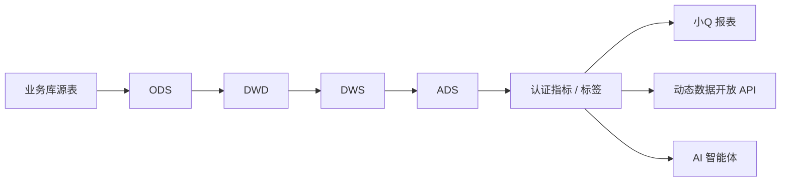

血缘的三个用处：
- **问题定位**：报表数字不对，沿血缘往上查到出错的那一层。
- **影响分析**：改表、改口径前，先查下游有哪些报表、API 受影响，通知到负责人。
- **下线判断**：没有下游、没有访问的表和任务，进入下线清单（见 1.4.8）。

### 1.4.5 数据质量

**规则按五个维度建**

| 维度 | 检查什么 | 例子 |
|---|---|---|
| 完整性 | 非空、记录数波动 | 订单号、景区 ID 不能为空；日订单量比近 7 日均值波动超过 30% 告警 |
| 准确性 | 值域、格式、业务逻辑 | 金额不能为负；核销时间不能早于下单时间；手机号格式合法 |
| 一致性 | 跨层、跨系统对账 | DWD 订单金额汇总等于业务库；ADS 核销量等于 DWS |
| 及时性 | 产出时间 | 核心 ADS 每天 7:00 前产出，晚于基线告警 |
| 唯一性 | 主键不重复 | 订单号 + 明细号唯一；同一张票不重复核销 |

**规则分强弱**

| | 强规则 | 弱规则 |
|---|---|---|
| 用在哪 | 核心表：订单、核销、结算、对外 API 的源表 | 一般表 |
| 失败后 | 全局阻断下游，通知负责人 | 只告警，不阻断 |
| 处理时限 | 当天修复 | 一周内修复 |

数据质量模块未购，在重要节点后加质量校验节点实现：任务结束即校验，不通过全局阻断，通知下发。

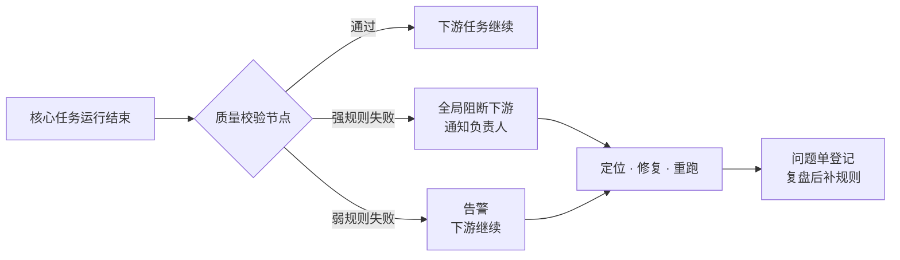

**问题闭环**：发现问题 → 定义规则 → 质量控制（告警 / 阻断）→ 质量评估 → 持续优化。每个问题登记问题单，同类问题出现两次就补规则。

**治理样板：核销逐层核对**。先把四个容易混用的指标分开：核销次数、有效核销票数、入园人次、去重游客数，再按景区 + 日期从源端到出口逐层核对。

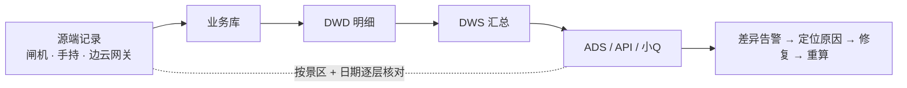

常见差异原因：设备离线补传、重复上报、撤销冲正、按下单时间还是核销时间统计混用。

### 1.4.6 统一标签

**两级体系**：集团统一输出标准指标和标准标签，经过分类分级后下发给景区和供应商；标准不够用时，各景区、供应商在自己的空间里自定义。

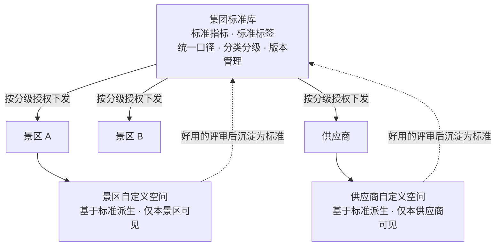

**分类分级**

| | 指标 | 标签 |
|---|---|---|
| 分类 | 交易、核销入园、渠道、结算、会员、业态 | 对象：游客 / 会员、景区、商品、渠道、供应商；类型：基础属性、统计、规则、预测 |
| 分级 | 按开放范围分：集团内部 / 景区可用 / 供应商可用 / 可对外 | 按 L1–L4 安全等级（见 1.4.7）；L4 标签不下发、不对外 |

**标签平台怎么展示和查看**：按“数据域 → 主题域 → 指标 / 标签”三级目录展示，按查看者的角色、租户和安全等级过滤可见内容。

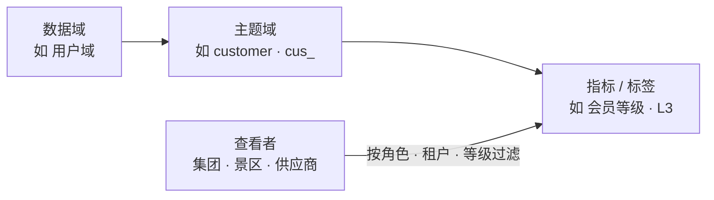

**自定义规则**
- 只能基于集团标准和本主体已授权的数据派生。
- 不能与集团标准同名，不覆盖、不影响其他景区或供应商。
- 只服务本景区或本供应商。
- 使用效果好的自定义指标、标签，评审后升级为集团标准。

**指标怎么定义**：每个指标按“原子指标 + 修饰词 + 时间周期 + 统计粒度”拆开定义。

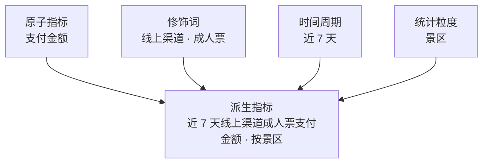

**认证流程**：数据团队起草 → 业务负责人确认 → 治理小组裁定 → 发布并版本化。只有认证过的指标和标签能进入管理层看板、API 和 AI。

### 1.4.7 权限安全

**数据分级**

| 等级 | 范围 | 管控 |
|---|---|---|
| L4 高敏 | 个人信息（手机号、证件号）、人脸、政务核验结果 | 加密存储、脱敏展示、最小授权、全程审计；明文不进入大模型 |
| L3 敏感 | 单景区经营数据、价格、结算、供应商合作数据 | 按景区 / 供应商隔离；跨主体只看汇总 |
| L2 内部 | 日志、设备状态、运营数据、匿名聚合 | 内部按角色授权 |
| L1 公开 | 已发布的报告、规范 | 可公开 |

**权属边界**

| 数据 | 规则 |
|---|---|
| 景区数据 | 只服务该景区本身 |
| 供应商数据 | 只服务该供应商 |
| 渠道数据 | 不向其他渠道披露 |
| 游客信息 | 在用户授权范围内使用 |
| 政务数据 | 只用核验结果，不留原始数据 |
| 外部采购数据 | 按合同约定范围使用 |
| 对外输出 | 仅限匿名聚合结果 |

**权限模型：角色 × 数据范围 × 字段等级**

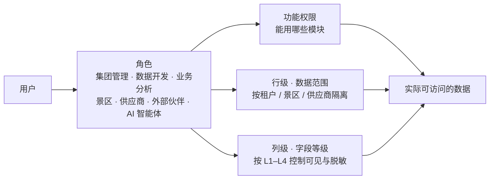

| 角色 | L1 | L2 | L3 | L4 |
|---|---|---|---|---|
| 集团管理层 | 可看 | 可看 | 可看汇总 | 不可看明细 |
| 数据团队 | 可看 | 可看 | 按项目授权 | 审批后脱敏使用 |
| 业务线 | 可看 | 可看 | 本业务线 | 不可看 |
| 景区 | 可看 | 本景区 | 本景区 | 本景区游客，授权后脱敏 |
| 供应商 | 可看 | 本供应商 | 本供应商 | 不可看 |
| 外部伙伴 | 可看 | 不可看 | 仅匿名聚合 | 不可看 |
| AI 智能体 | 继承提问人的权限 | | | |

**权限流程：申请—审批—授权—使用—回收**

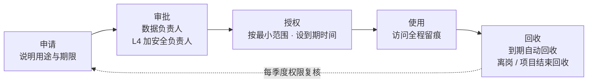

**各出口统一管控**

| 出口 | 管控方式 |
|---|---|
| 湖仓 / DataStudio | 项目、表、字段级授权；开发环境使用脱敏数据 |
| 数据地图 | 可搜索资产目录，按权限申请使用 |
| 动态数据开放 API / 数据服务 | 应用鉴权、租户隔离、字段按等级脱敏、调用审计 |
| 小Q | 行级权限（按景区 / 供应商）、列级权限 |
| 标签平台 | 按数据域分级查看；L4 标签不下发 |
| AI 智能体 | 继承提问人权限；只调用认证指标和授权数据；L4 明文不进入模型 |

**技术手段**
- 敏感字段自动识别与打标：用 AI 加规则识别证件号、手机号、人脸等字段，由安全负责人复核。
- 脱敏、行列权限、租户隔离、访问留痕。
- 安全中心模块未购：先用计算引擎权限加脱敏视图实现；合规要求提高时评估增购。

### 1.4.8 资产运营

**资产目录**：数据地图按“数据域 → 主题域 → 表 / 指标 / 标签 / API”编目，可搜索、可看口径和血缘、按权限申请使用。

**健康分**：数据资产治理模块按负责人、主题域打分，每月公示排名。

| 维度 | 看什么 |
|---|---|
| 规范 | 命名、注释、负责人、安全等级是否齐全 |
| 质量 | 质量规则覆盖率、通过率、按时产出率 |
| 安全 | 敏感字段是否打标、是否脱敏 |
| 使用 | 访问次数、下游引用数 |
| 成本 | 存储量、计算耗时、重复计算 |

**成本治理与下线**

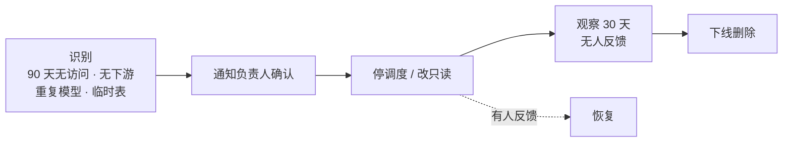

- 临时表设生命周期自动清理；ODS 分区按用途设保留期。
- 重复模型合并到公共层，先双跑对比再切换。

### 1.4.9 数据分发

所有对内对外的数据都从统一出口走，不再点对点导数、私接数据库。动态数据开放 API 作为统一出口，同时提供 ADS 指标和标签服务，两者可以联合使用。

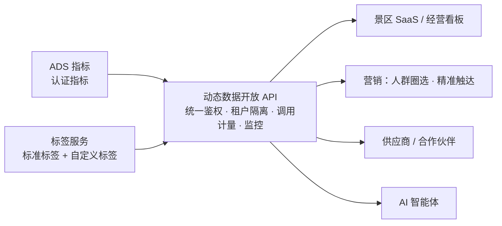

| 用法 | 例子 |
|---|---|
| 只查指标 | 景区经营看板：销售额、核销量、入园人次 |
| 指标 + 标签联合 | 按会员等级看复购率；按游客偏好看各票种销量 |
| 标签圈人 + 指标评估 | 圈选“近 90 天未复购的年卡用户”推送活动，活动后用指标看转化 |
| 只查标签 | 智能体按游客标签做个性化推荐 |

### 1.4.10 治理嵌入开发

治理卡点放进研发的每一步，不另起流程：

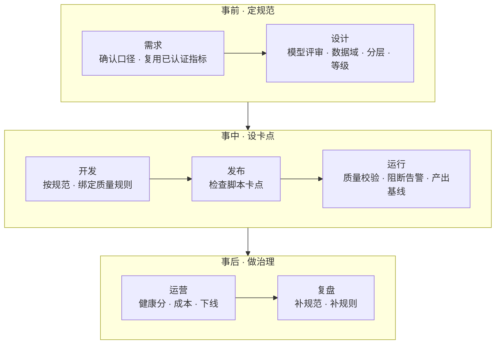

| 阶段 | 事前 · 定规范 | 事中 · 设卡点 | 事后 · 做治理 |
|---|---|---|---|
| 做什么 | 命名规范、指标定义、模型评审 | 发布自动检查、质量规则绑定任务、失败阻断下游 | 健康分公示、存量整改、问题复盘 |
| 谁来做 | 数据架构师、治理专员 | 平台自动执行 | 数据负责人、治理专员 |
| 不做到会怎样 | 模型不能进入开发 | 不能发布；下游不运行 | 健康分低的负责人排名公示，限期整改 |

### 1.4.11 治理组织

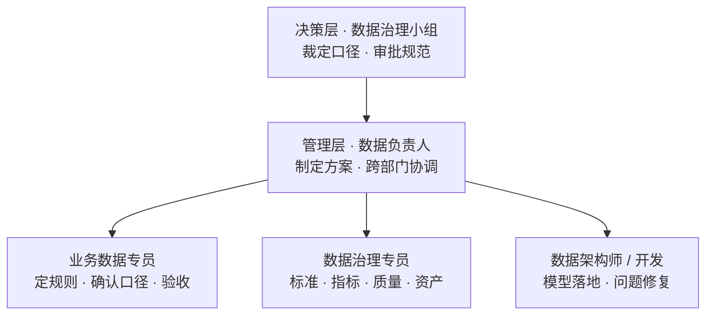

机制：两周一次口径评审，每月公示健康分，每季度复盘。

| 角色 | 职责 |
|---|---|
| 数据治理小组 | 裁定口径争议，审批规范和指标认证 |
| 数据负责人 | 制定治理方案，跨部门协调，对健康分负责 |
| 业务数据专员（各业务线一名） | 提业务规则，确认口径，验收数据 |
| 数据治理专员 | 维护标准、指标字典、质量规则、资产目录 |
| 数据架构师 / 开发 | 模型设计评审，规范落地，问题修复 |

### 1.4.12 治理度量

| 领域 | 指标 | 建议目标（试点链路） |
|---|---|---|
| 数据标准 | 新表规范符合率 | 100% |
| 元数据 | 核心表注释、负责人覆盖率 | 100% |
| 主数据 | 景区、商品、渠道编码映射覆盖率 | 100% |
| 数据质量 | 核心表强规则覆盖率；核心 ADS 按时产出率 | 100%；≥ 99% |
| 指标 | 管理层看板中认证指标占比 | 100% |
| 安全 | 敏感字段识别打标覆盖率 | 100% |
| 资产 | 无用表、无用任务下线 | 每季度清理一轮 |
| 一致性 | 核销量各出口差异 | 0 差异，或差异有原因说明 |

## 1.5 建设落地

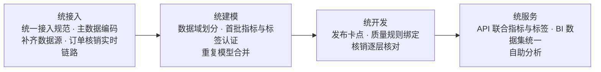

- 先在“订单 → 核销 → 结算”试点，做通后推广到其他数据域。
- 存量模型先双跑对比再切换，保留回滚。

平台建成后，体现为六个看得见的变化，每个都有关键指标可考核；最后汇总为对企业和对业务线的影响。

> 关键指标的目标值为建议值，试点链路跑通后校准。

### 1.5.1 统一规范

规范不再停留在文档里：新表不合规发不出去，存量核心表优先整改，健康分月度公示。

```figure figures/1.6.1_规范落地.html
命名拆解 dwd_ord_order_item_di（分层 · 主题域 · 业务过程与粒度 · 更新方式）
DDL 必填：中文名、描述、负责人、安全等级、生命周期、分区字段、字段注释、发生时间与上报时间
新建 · 卡点（发布前自动检查，不合规不发布）→ 存量 · 整改（核心表优先，AI 补描述）→ 持续 · 运营（资产健康分，月度公示）
```


### 1.5.2 统一底座

离线与实时是两种计算方式，湖仓负责统一存储与管理；订单、核销从次日可见变为分钟级。

```figure figures/1.6.2_统一底座.html
业务库 / 渠道接口 / 设备事件 / 行为日志 / 外部数据 → 统一接入（接入规范 · 对象标识 · 负责人）
→ 湖仓一体（离线计算 DataWorks；实时计算 订单、核销先行；ODS DWD DIM DWS ADS；共享业务定义与质量规则）
→ 分析查询（稳定查询 · 负载隔离）→ 小Q / API / AI
稳定与扩展：结构变更、失败恢复、补数重算、租户隔离、高峰压测
预期产出：统一接入、离线与实时处理、湖仓底座、公共模型及标准数据集
```


### 1.5.3 统一湖仓

重复模型合并到公共层，同一个指标不再有两个结果，改口径只改一处。

```figure figures/1.6.3_离线与湖仓合一.html
现状：两条链路（离线：源数据 → 离线模型 → 指标 A；湖仓：源数据 → 湖仓模型 → 指标 A′）
目标：一个底座（公共层 DWD · DIM · DWS 只建一次；离线计算 + 实时计算 → 统一指标 → BI · API · AI）
合并步骤：盘点重叠模型 → 确定保留版本 → 下游改为引用 → 双跑对比 → 下线重复模型
```


### 1.5.4 统一标签

同一出口，按景区隔离；同名不能覆盖企业标准。BI、API、AI 三处数字一致。

```figure figures/1.6.4_指标统一.html
公共模型（明细 · 维度 · 汇总）→ 企业标准指标（统一定义 · 版本管理 · 业务认证）/ 景区自定义指标空间（景区 A、B、C，相互隔离）
景区指标评审后沉淀为标准；统一输出到 小Q / 动态数据开放 API / AI 问数
```


### 1.5.5 标签复用

OneID：订单、会员、年卡、人脸识别归并为同一游客；标签一处加工，营销、分析、AI、景区都从这里取。

```figure figures/1.6.5_标签复用.html
统一生产（基于 DIM / DWS 公共模型加工）→ 统一管理（口径 · 负责人 · 生命周期）→ 统一服务（营销 · 分析 · AI · 景区）
标签对象：游客 / 会员、供应商、景区、渠道、商品
标签类型：基础属性、统计类、规则类、模型预测类
边界：景区只用本景区标签 · 不做敏感个人信息标签 · 对外不提供个体标签
```


### 1.5.6 自助分析

从统一的模型、指标、标签出发，业务自己分析；数据团队从临时取数转向建模型。

```figure figures/1.6.6_自助分析.html
统一出发点（模型 · 指标 · 标签）→ 小Q 自助分析（指标检索、明细探索、可视化计算、自定义看板、报表订阅）→ 总部经营 / 业务线 / 景区
AI 问数与 BI 同源：共用指标定义和权限
预期产出：企业指标中心 · 景区专属指标空间 · 统一标签服务 · 统一语义服务 · 自助分析平台
```

### 1.5.7 落地效果

建成后，从“找人要数”变成“数据找人”：数字可信、看数及时、用数自助。

**对企业：五个方面都有可衡量的变化**

```figure figures/1.5.7_对企业.html
可信：一个指标一个口径，数字可追溯｜认证指标覆盖率、对账差异率
时效：订单、核销 T+1 → 分钟级｜端到端延迟
效率：公共模型复用，改动影响可预判｜模型复用率、交付周期
成本：重复模型、无用报表和任务下线｜存储计算成本
安全：敏感数据分级、脱敏、可审计｜敏感字段识别覆盖率
原则：先建立基线再定目标；以实际使用和业务结果衡量，不以上线看板数量衡量
```

**对业务线：每类角色都用上可信数据**

```figure figures/1.5.7_对业务线.html
管理层：驾驶舱全用认证指标，不再先对数
票务：核销口径统一，差异自动定位；节假日实时看数
财务：业务与财务逐层对账，差异自动列出原因
渠道：销量、佣金、返利口径统一
营销：标签圈人、指标看效果，活动复盘自动完成
运营 / 客户成功：景区经营报告自动生成
产品研发：上线前定好埋点和口径，上线即有数据
数据团队：从临时取数、对数转向建模型、做分析
景区 / 供应商：直接用集团标准指标和标签；不够用时在自己的空间里自定义
```

**为第二章打基础**：治理后的指标、标签、知识可信、有口径、有权限，AI 接上它们才能答得准。

---

# 二、智能体平台

## 2.1 现状

```figure figures/2.1_现状.html
扣子（Coze）工作流 ：智能助手、智能客服、智能导览、AI 旅拍、AI 伴游 —— 面向游客
企业合作：手语 —— 面向听障游客
小Q 能力：智能问数、智能数据解读 —— 面向景区与内部管理者
```

| 智能体 | 面向 | 来源 | 交付方式 |
|---|---|---|---|
| 智能助手、智能客服、智能导览、AI 旅拍、AI 伴游 | 游客 | Coze | 在扣子上配置工作流形成智能体，标准化、配置化输出 |
| 手语 | 听障游客 | 企业合作 | 接入合作方能力 |
| 智能问数、智能数据解读 | 景区、内部管理者 | 小Q | 使用 小Q 的 AI 能力 |

## 2.2 场景沉淀

票付通的产品覆盖票务、业态、运营、财务、终端，并已发布覆盖游客服务、景区管理、精准营销、安全运营的 AI 产品矩阵。按这四类场景，结合产品全景，可做智能体和 AI 服务的场景分层如下：

```layers
游客服务 | AI 旅游规划, 智能客服*, 智能助手*, AI 智能购票, 智能导览*, AI 伴游*, 手语*, AI 旅拍*
精准营销 | 会员画像, 人群圈选, 年卡续费提醒, 全民营销推荐, 活动效果复盘
景区管理 | 智能问数*, 智能数据解读*, 移动驾驶舱, 票务 AI 运营助手, AI 对账助手, 消息预警, 工单处置
安全运营 | 旅游安全, 秩序治理, 车辆调度, 游船调度, 森林防火, 生态监测, 气象服务, 设施监测
~业务与数据 | 售检票与分销, 景区业态 9 类, 年卡 · 分时预约 · 人脸, 财务与电子发票, 智慧终端 · 边云网关
@场景沉淀 | 景区交易数据, 票务与业态知识, 业务系统接口, 闸机与物联设备, 景区服务经验
```

> 渐变色块为已有智能体，白色块为全景中可做的场景。四层分别对应畅游 AI、会员营销、AI 数字大脑（景数通 / 票付通 APP）、景区 AI 调度中枢，底层为智慧票务系统。

| 场景层 | 服务谁 | 解决什么 | 依托的产品与数据 |
|---|---|---|---|
| 游客服务 | 游客 | 游前规划咨询购票，游中导览伴游，游后旅拍分享 | 畅游小程序、售票系统、景区知识 |
| 精准营销 | 景区营销人员 | 找对人、推对产品、看清效果 | 会员积分、年卡、全民营销、统一标签 |
| 景区管理 | 景区管理者、我方运营 | 看数、找问题、对账、运营提效 | 景数通、票付通 APP、财务报表、认证指标 |
| 安全运营 | 景区安全与调度人员 | 客流、车船、安防、生态的预警与处置 | 调度中枢、闸机与边云网关、物联与气象数据、工单 |
| 业务系统与数据 | —— | 所有智能体的数据和动作来源 | 智慧票务全系列、第一章的数据平台 |

**我们的优势**：智能体要“能办事”，靠的是业务系统和数据。票付通的票务、业态、终端系统在景区现场，交易数据、业务接口和景区服务经验是通用 AI 厂商没有的。

## 2.3 建设思路：三阶段

先借成熟平台快速验证、快速占市场，再用沉淀下来的能力、经验和市场建自己的平台。

```figure figures/2.3_三阶段.html
阶段一 · 快速验证：依托成熟平台快速做出智能体，在标杆景区验证效果，跑通商业模式
阶段二 · 市场占有：依托成熟平台，快速复制到各大业态景区，扩大市场占有率，持续沉淀
阶段三 · 能力自给：基于前两阶段的沉淀，建设自己的智能体平台
阶段一、二依托成熟平台 / 框架：Coze、火山方舟、羚羊小Q；阶段三自建
```

| 阶段 | 定位 | 依托 | 目标 |
|---|---|---|---|
| 阶段一 · 快速验证 | 快速做出来、验证、跑通商业模式 | Coze、火山方舟、羚羊小Q | 产品可卖、定价可行、交付可复制 |
| 阶段二 · 市场占有 | 快速复制到各大业态景区 | 同上 | 最快扩大市场占有率，沉淀能力、经验、需求 |
| 阶段三 · 能力自给 | 建设自己的智能体平台 | 前两阶段的沉淀 | 成本可控、交付更快、形成壁垒 |

## 2.4 阶段一：快速验证

在成熟平台上把现有 8 个智能体和全景中价值最高的场景快速做出来，到标杆景区验证。

```figure figures/2.4_验证闭环.html
选场景 → 成熟平台上搭建 → 标杆试点 → 看效果 → 定价与交付定型
验证什么：有没有人用、能不能解决问题、景区愿不愿付费、多久能交付、单景区成本
迭代：效果不好的回到平台调整；没人用的场景及时停
```

| 要跑通的 | 验证标准 |
|---|---|
| 产品 | 游客和景区真的在用，问题解决率、满意度达到预期 |
| 商业 | 景区愿意付费，定价方式（随票务打包或单独收费）确定 |
| 交付 | 一个景区从签约到上线的流程和周期固定下来 |
| 成本 | 单景区的调用和交付成本算得清，有利润空间 |

## 2.5 阶段二：市场占有

把阶段一验证过的智能体，依托成熟平台快速复制到各大业态景区，最快扩大市场占有率；同时持续沉淀能力、经验和市场需求。

```figure figures/2.4.2_复制交付.html
复制流程：签约 → 选已验证模板 → 配本景区知识 → 绑定入口 → 测试验收 → 上线运营
覆盖业态：山岳、乐园、古镇街区、博物馆、温泉度假、游船演出
同步沉淀：场景模板、景区知识结构、业务接口、交付经验、需求清单、交互数据
```

**怎么快速占市场**

| 打法 | 做法 |
|---|---|
| 存量先行 | 先推给已用票付通票务系统的景区，接口现成、关系现成，开通最快 |
| 标杆引路 | 每类业态先做 1 家标杆，再复制同类 |
| 随票务打包 | 智能体作为票务系统的增值模块一起推，降低单独采购门槛 |

**阶段二的弊端**：依托成熟平台能快，但规模越大问题越明显。

```figure figures/2.5_弊端.html
成本越做越高：按调用、账号、空间收费，景区越多平台费越高，利润被平台分走
交付受限：功能受平台限制，个性需求做不了；多个平台分别配置、分别维护
资产在外部：工作流、知识库、对话数据留在第三方平台，难沉淀、难迁移
管理分散：多平台多入口，权限、计量、监控各管各的
受制于人：平台调价、改规则、下线功能，直接影响交付和报价
难形成壁垒：同样的平台谁都能用；景区和游客数据出域有合规顾虑
```

## 2.6 阶段三：能力自给

用前两阶段沉淀的能力、经验和市场，建设自己的智能体平台，由数字大脑作为智能体管理台统一承载。

```figure figures/2.6_平台.html
自建智能体平台（数字大脑作为智能体管理台）：智能体应用、智能体搭建、能力与知识、运营管理
模型与能力：大模型（多家可替换）、语音图像等多模态、小Q、合作企业专项能力
```

### 2.6.1 总体架构

```layers
入口 | 畅游小程序*, 票付通 APP*, 景数通*, 公众号/小程序*, 智慧终端*
智能体应用 | 游客服务, 景区管理, 票务财务, 安全调度, 精准营销
智能体搭建 | 场景模板, 配置化生成, 多智能体协同, 版本管理
能力与知识 | 业务工具, 景区知识, 数据服务, 多模态与数字人
~模型与能力 | 大模型（可替换）, 多模态, 小Q*, 合作企业*
@运营管理/贯穿各层 | 统一接入, 权限与租户, 运行监控, 成本统计, 效果评估
```

> 中间三层和右侧运营管理为自建；前两阶段沉淀的模板、知识、接口直接迁入。

### 2.6.2 全流程管理

```figure figures/2.3.2_全流程.html
能力接入 → 搭建 → 测试 → 发布 → 运行 → 监管 → 优化
集团 / 景区：集团统一建设，景区开通使用、按需定制，数据按景区隔离
闭环：运行中发现的问题回到搭建环节修正，所有景区同步受益
```

### 2.6.3 全景智能体

产品全景中的智能体，已有 8 个，还有 14 个待建，最终都由自建平台统一承载：

```figure figures/2.3.2_全景智能体.html
畅游 AI：已有 智能助手、智能客服、智能导览、AI 伴游、AI 旅拍、手语；待建 AI 旅游规划、AI 智能购票
AI 数字大脑：已有 AI 智能问数、AI 智能洞察；待建 消息通知预警、工单调度处置
智慧票务：待建 票务 AI 运营助手、AI 对账助手
景区 AI 调度中枢：待建 旅游安全、秩序治理、车辆调度、游船调度、森林防火、生态监测、气象服务、设施监测
```

### 2.6.4 自建能省什么

```figure figures/2.6_省什么.html
成本：阶段二平台费随规模线性上涨；阶段三只付模型调用，规模越大越省
交付周期：阶段二多平台分别配置；阶段三集团建一次，景区开通即用
定制能力：阶段二受平台功能限制；阶段三按景区需求自主扩展
数据资产：阶段二留在外部平台；阶段三沉淀在自己手里，回流数据平台
竞争力：阶段二同平台谁都能做；阶段三业务 + 数据 + 平台一体
```

| 对比 | 阶段二 · 依托成熟平台 | 阶段三 · 自建平台 | 对企业的影响 |
|---|---|---|---|
| 成本 | 平台费按调用、账号计，随景区数增长 | 只付模型调用和自身运维 | 单景区成本下降，规模越大利润越高 |
| 交付周期 | 每个景区在外部平台单独配置、调试 | 集团建一次，景区开通即用 | 省交付人天，上线更快，可承接更多景区 |
| 定制能力 | 个性需求受平台限制 | 自主扩展 | 能接大客户和个性项目 |
| 数据资产 | 工作流、知识、对话数据在外部 | 全部在自己手里，回流数据平台 | 越用越准，数据成为资产 |
| 风险 | 平台调价、改规则直接影响报价 | 自主可控，模型可替换 | 经营稳定，报价有底 |
| 竞争力 | 同平台谁都能做 | 业务系统 + 数据 + 平台一体 | 形成壁垒，提高续约和客单价 |

### 2.6.5 怎么切过去

```figure figures/2.6_切换.html
① 平台核心能力上线 → ② 新景区先上自建 → ③ 存量随续约逐步迁移（双轨运行、可回退）→ ④ 成熟平台转为补充
何时启动：景区规模上来、平台费占比明显上升、标准场景已稳定、个性需求平台满足不了
```

**贯穿三个阶段的底线**

| 底线 | 做法 |
|---|---|
| 只用授权数据 | 数据按景区隔离，景区只能看到本景区数据 |
| 关键动作人工确认 | 退款、调度等处置动作需人工确认 |
| 不碰敏感信息 | 手机号、证件号不进入对话和知识库，展示时脱敏 |
| 不乱承诺 | 价格、退改规则以系统返回为准，答不了就转人工 |

---

# 三、AI＋数据平台联合
