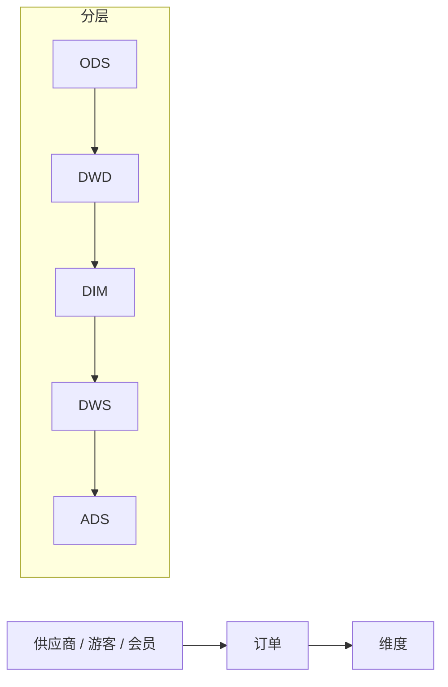
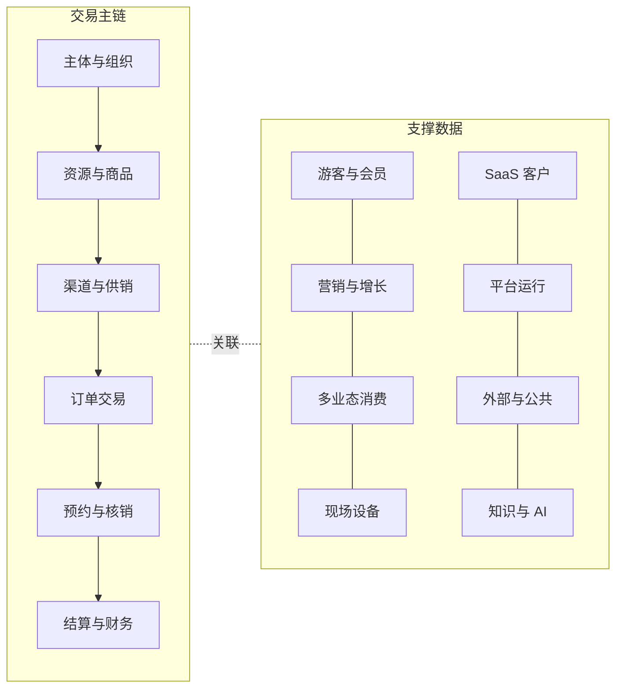
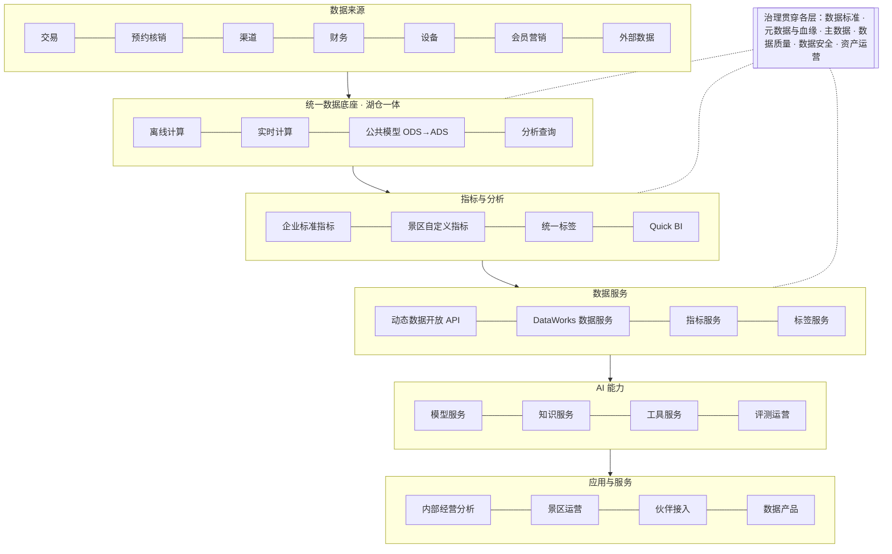
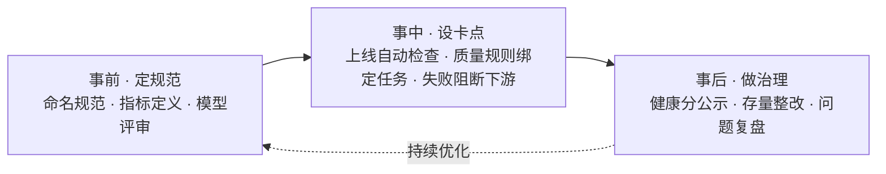
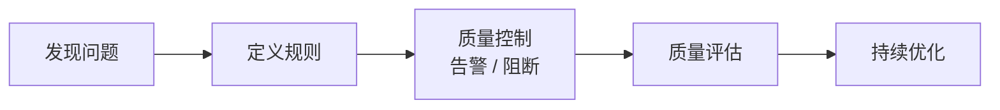
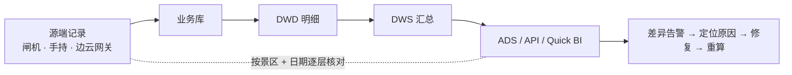
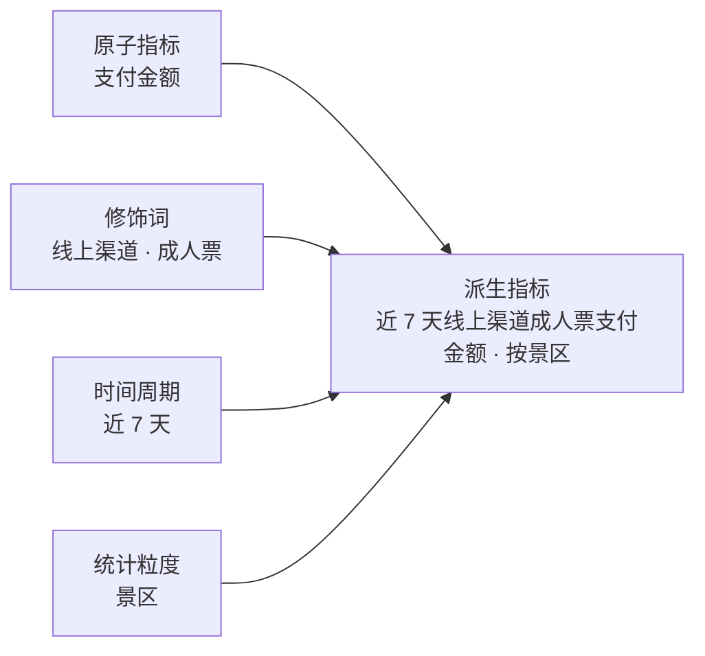
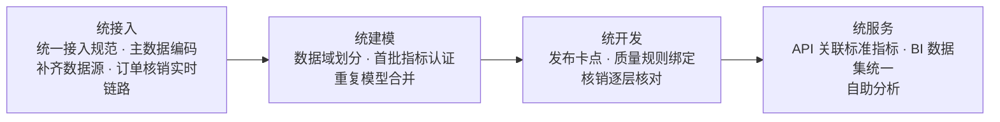
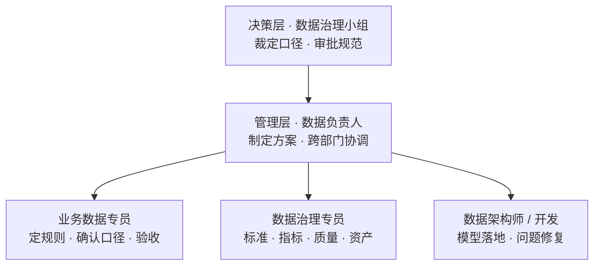

# AI＋数据平台建设汇报（正文）

> 本稿按《AI＋数据平台汇报大纲》展开，分三章：一、数据平台；二、AI 智能体平台；三、AI＋数据平台联合。
> 当前进度：**第一章已完成**，第二、三章待写。

---

# 一、数据平台

## 1.1 现状

**已有**
- DataWorks：已购 DataStudio、运维中心、数据地图、数据资产治理、数据服务。
- 动态数据开放 API：对内对外提供指标。
- Quick BI：报表展示。
- 湖仓：部分模型。

**已建成**：离线主流程已贯通。

**未建设**：实时链路、数据质量、统一标签、指标口径管理、数据标准落地。

## 1.2 问题

| 问题 | 例子 | 根因 |
|---|---|---|
| 数据孤岛 | 做一份“售票 + 二消 + 结算”综合分析，要从 3 个以上系统导数手工拼表 | 没有统一接入，景区、商品、渠道编码不一致 |
| 口径不一 | 同一天同一景区，看板、对账、API 三处“核销量”不同 | 没有企业级指标定义 |
| 规范缺失 | 表名随意、字段无注释、DDL 无负责人 | 规范只在文档里，上线无卡点 |
| 模型重复 | 订单宽表离线、湖仓各一份，结果不同 | 没有统一公共层 |
| 数字不准 | 入园、核销与源端对不上，节假日尤甚 | 补传、重复上报、撤销冲正、时间口径混用，缺逐层核对 |
| 缺少实时 | 高峰期订单、核销次日才能看到，预警靠人工 | 只有离线 T+1 链路 |

**结论**：前五类根因相同，都是缺少统一的标准、模型、口径和校验，必须体系化治理；实时是能力缺口，要在统一公共模型上补。

## 1.3 我们有哪些数据

- 入仓情况：主体、订单、会员已入仓（主流程），其余数据域部分入仓。
- 难点不在数据量，在于节假日高峰、订单状态多次变更、设备离线补传和多租户隔离。

## 1.4 怎么建

**思路**：统一标准、治理嵌入研发、先试点后推广（试点链路：订单 → 核销 → 结算）。

### 1.4.1 总体架构：六层分层建设，治理贯穿始终

### 1.4.2 平台组件：七组能力，在已有工具上升级与新建

| 能力组 | 已有 | 升级 | 新建 |
|---|---|---|---|
| 数据集成 | 批量同步 | 埋点采集、边云回传 | 实时采集、标准连接器 |
| 存储计算 | 离线计算 | — | 实时计算、湖仓统一存储 |
| 开发运维 | DataStudio、运维中心 | 数据建模 | 发布卡点、成本治理 |
| 数据治理 | 数据地图、数据资产治理 | 血缘、健康分 | 数据质量、数据标准、分级脱敏 |
| 指标标签 | — | — | 指标中心、景区指标空间、标签平台 |
| 服务分析 | 动态数据开放 API、DataWorks 数据服务、Quick BI | 统一出口 | 嵌入式分析 |
| AI 能力 | — | AI 问数 | 模型网关、知识检索、评测 |

未购模块的处理：
- 数据质量：建议增购；或用 DataStudio 校验任务加运维中心告警替代。
- 数据标准：先用规范文档加发布前检查脚本。
- 安全中心：先用计算引擎权限加脱敏视图。
- 实时计算：新增，先做 POC。

### 1.4.3 治理体系：六项内容

| 内容 | 做什么 |
|---|---|
| 数据标准 | 统一字段、码值、命名规范 |
| 元数据与血缘 | 补齐业务含义和负责人；源表 → 模型 → 指标 → 报表的血缘 |
| 主数据 | 景区、商品、渠道、供应商、游客统一编码，源头“先查再建” |
| 数据质量 | 完整、准确、一致、及时四类规则；关键规则失败时阻断下游 |
| 数据安全 | 分类分级、脱敏、字段级权限、访问审计 |
| 资产运营 | 资产目录、健康分、无用资产下线 |

### 1.4.4 治理嵌入研发：事前、事中、事后

质量问题处理流程：

### 1.4.5 治理样板：核销逐层核对

先把四个容易混用的指标分开：核销次数、有效核销票数、入园人次、去重游客数。

### 1.4.6 指标口径统一

认证流程：数据团队起草 → 业务负责人确认 → 治理小组裁定 → 发布并版本化。只有认证指标能进入管理层看板、API 和 AI 问数。

### 1.4.7 建设路径：四步走

- 先在“订单 → 核销 → 结算”试点，做通后推广到其他数据域。
- 存量模型先双跑对比再切换，保留回滚。

### 1.4.8 组织保障

机制：两周一次口径评审，每月公示健康分，每季度复盘。

## 1.5 建成后的效果

**对企业**

| 方面 | 变化 | 衡量 |
|---|---|---|
| 可信 | 一个指标一个口径，数字可追溯 | 认证指标覆盖率、对账差异率 |
| 时效 | 订单、核销从 T+1 到分钟级 | 端到端延迟 |
| 效率 | 优先复用公共模型，改动影响可预判 | 模型复用率、需求交付周期 |
| 成本 | 重复模型、无用报表和任务下线 | 存储计算成本 |
| 安全 | 敏感数据分级、脱敏、可审计 | 敏感字段识别覆盖率 |

**对业务线**

| 业务线 | 治理后的变化 |
|---|---|
| 票务 | 核销口径统一，差异自动定位；节假日实时看数 |
| 财务 | 业务与财务逐层对账，差异自动列出原因 |
| 渠道 | 渠道销量、佣金、返利口径统一 |
| 运营 / 客户成功 | 景区经营报告自动生成 |
| 产品研发 | 上线前定好埋点和口径，上线即有数据 |
| 管理层 | 驾驶舱全部用认证指标，不再先对数 |
| 数据团队 | 从临时取数、对数转向建模型、做分析 |

**为第二章打基础**：治理后的指标、标签、知识可信、有口径、有权限，AI 接上它们才能答得准。

---

# 二、AI 智能体平台

（待写，按大纲第二章展开）

---

# 三、AI＋数据平台联合

（待写，按大纲第三章展开）

---

## 参考资料

第一章参考：`参考资料/数据治理/` 下 5 篇文章（OneData 方法论与四步建设路径、数据治理操作指南、数据治理定义、数据治理方法与流程、数据仓库 / 湖 / 湖仓区别）。
