# AI＋数据平台

> 本稿按《AI＋数据平台汇报大纲》展开，分三章：一、数据平台；二、AI 智能体平台；三、AI＋数据平台联合。
> 当前进度：**第一章已完成**，第二、三章待写。

---

# 一、数据平台

## 1.1 数据现状

**已有**
- DataWorks：已购 DataStudio、运维中心、数据地图、数据资产治理、数据服务。
- 动态数据开放 API：对内对外提供指标。
- Quick BI：报表展示。
- 湖仓：部分模型。

**已建成**：离线主流程已贯通。

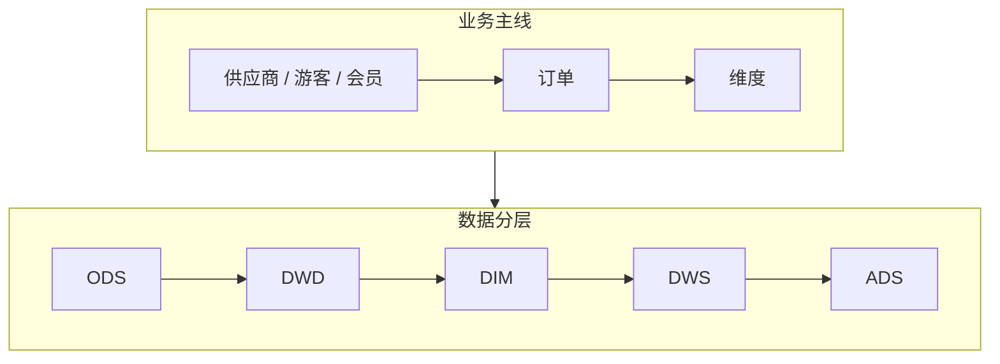

**未建设**：实时链路、数据质量、统一标签、指标口径管理、数据标准落地。

**存在的问题**

| 问题 | 例子 | 根因 |
|---|---|---|
| 数据孤岛 | 做一份“售票 + 二消 + 结算”综合分析，要从 3 个以上系统导数手工拼表 | 没有统一接入，景区、商品、渠道编码不一致 |
| 口径不一 | 同一天同一景区，看板、对账、API 三处“核销量”不同 | 没有企业级指标定义 |
| 规范缺失 | 表名随意、字段无注释、DDL 无负责人 | 规范只在文档里，上线无卡点 |
| 模型重复 | 订单宽表离线、湖仓各一份，结果不同 | 没有统一公共层 |
| 数字不准 | 入园、核销与源端对不上，节假日尤甚 | 补传、重复上报、撤销冲正、时间口径混用，缺逐层核对 |
| 缺少实时 | 高峰期订单、核销次日才能看到，预警靠人工 | 只有离线 T+1 链路 |

**结论**：前五类根因相同，都是缺少统一的标准、模型、口径和校验，必须体系化治理；实时是能力缺口，要在统一公共模型上补。

## 1.2 数据沉淀

湖仓按**主题域**划分，主题域再归并为**数据域**。数据域用于数据地图、标签平台的目录展示和分级查看。

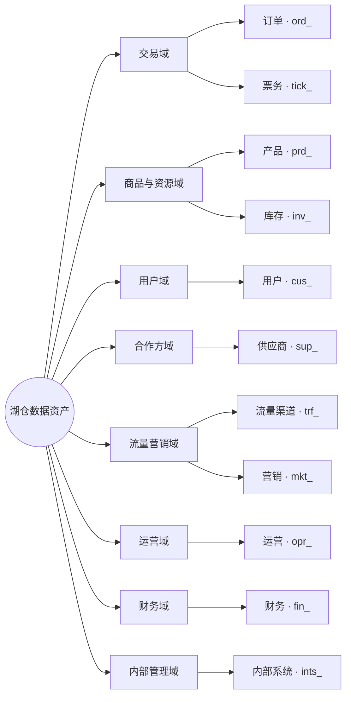

| 数据域 | 主题域（前缀） | 说明 | 指标 / 标签示例 | 默认等级 |
|---|---|---|---|---|
| 交易域 |  `ord_` `tick_` | 订单、预订；票务 | 订单数、销售额、核销次数；近 30 天购票次数 | L3 |
| 商品与资源域 |  `prd_` `inv_` | 产品（机票、酒店、度假）；库存（房量、机位） | 售罄率、库存余量；热销产品 | L2 |
| 用户域 |  `cus_` | 用户、旅客 | 会员等级、复购倾向、出游偏好 | L4（明细）/ L3（标签） |
| 合作方域 |  `sup_` | 供应商（酒店、航司、地接） | 履约率、结算周期；供应商等级 | L3 |
| 流量营销域 |  `trf_` `mkt_` | 流量、渠道；营销、活动 | 渠道转化率、活动 ROI；渠道偏好 | L3 |
| 运营域 |  `opr_` | 运营（航班、酒店房态） | 房态占用率、准点率 | L2 |
| 财务域 |  `fin_` | 财务、结算 | 应结 / 已结金额、对账差异 | L3 |
| 内部管理域 |  `ints_` | 内部系统 | 任务运行、存储计算成本 | L2 |

- 表命名：`层级_主题域前缀_业务过程_粒度_更新方式`，如 `dwd_ord_order_item_di`。
- 等级 L1–L4 定义见 1.4.7。
- 入仓情况：订单、用户、供应商已入仓（主流程），其余主题域部分入仓。
- 待扩展：现场设备、外部数据、知识与 AI 数据暂无主题域，建议后续新增。
- 难点不在数据量，在于节假日高峰、订单状态多次变更、设备离线补传和多租户隔离。

## 1.3 数据建设

**思路**：统一标准、治理嵌入研发。

### 1.3.1 总体架构

**六层分层建设，治理贯穿始终**

```layers
应用与服务 | 内部经营, 景区运营, 伙伴接入, 行业报告, 数据产品
AI 能力 | 模型服务, 知识服务, 工具服务, 评测运营
数据服务 | 动态数据开放 API*, 指标服务, 标签服务, 一键接入
指标与分析 | 企业标准指标, 景区自定义指标, 统一标签, Quick BI*
统一底座 | DataWorks*, 离线主流程*, 实时计算, 湖仓存储, 公共模型, 分析查询
~数据来源 | 票务, 订单, 小程序, 供应商, 营销, 渠道, 设备, 外部数据
@治理与资产/贯穿各层 | 数据标准, 数据地图, 数据血缘, 数据质量, 权限安全, 资产目录
```

> 渐变色块为已有能力，白色块为新建或升级。

### 1.3.2 平台组件

```components
数据集成 | 批量同步*, 埋点采集+, 边云回传+, 实时采集, 标准连接器
存储计算 | 离线计算*, 实时计算, 湖仓统一存储
开发运维 | DataStudio*, 运维中心*, 数据建模+, 发布卡点, 成本治理
数据治理 | 数据地图*, 数据资产治理*, 血缘+, 健康分+, 数据质量, 数据标准, 分级脱敏
指标标签 | 指标中心, 标签系统, 景区 / 供应商自定义空间
服务分析 | 动态数据开放 API*, DataWorks 数据服务*, Quick BI*, 统一出口+, 嵌入式分析
AI 能力 | AI 问数+, 模型网关, 知识检索, 评测
```

> 写法：`*` 已有，`+` 升级，不加标记为新建。

未购模块的处理：
- 数据质量：重要节点增加任务结束进行质量校验，不通过全局阻断，通知下发。
- 数据标准：先用规范文档加发布前检查脚本。
- 安全中心：先用计算引擎权限加脱敏视图。
- 实时计算：新增，先做 POC。

## 1.4 数据治理

**思路**：治理不是单独搞一次运动，而是把规则写进研发流程，每张表、每个指标从设计到下线都过治理卡点。先治核心链路“订单 → 核销 → 结算”，做通后按数据域推广。

### 1.4.1 治理框架

```layers
治理目标 | 数字可信, 口径统一, 安全合规, 成本可控
治理领域 | 数据标准, 元数据与血缘, 主数据, 数据质量, 指标与标签, 安全与权限, 资产运营, 数据分发
治理方式 · 嵌入研发 | 事前 · 定规范, 事中 · 设卡点, 事后 · 做治理
落地工具 | DataStudio*, 运维中心*, 数据地图*, 数据资产治理*, 发布检查脚本, 质量校验节点
@组织与度量 | 治理小组 · 裁定, 数据负责人 · 推动, 治理专员 · 执行, 健康分 · 月度公示, 季度复盘
```

> 图例：带 * 为已购 DataWorks 模块（深色）；发布检查脚本、质量校验节点为自建，替代未购的数据标准、数据质量模块。

| 领域 | 管什么 | 主要产出 | 落地工具 | 衡量 |
|---|---|---|---|---|
| 数据标准 | 命名、分层、字段、码值 | 规范文档、标准码表、检查脚本 | DataStudio + 发布检查脚本 | 规范符合率 |
| 元数据与血缘 | 表和字段的含义、负责人、上下游 | 资产目录、血缘图 | 数据地图 | 注释 / 负责人覆盖率 |
| 主数据 | 景区、商品、渠道、供应商、游客编码 | 主数据表、编码映射表 | 湖仓 DIM 层 | 编码重复率、映射覆盖率 |
| 数据质量 | 完整、准确、一致、及时、唯一 | 质量规则库、问题单 | 质量校验节点 + 运维中心告警 | 规则覆盖率、按时产出率 |
| 指标与标签 | 口径、分类分级、认证 | 指标字典、标签目录 | 指标中心、标签系统（新建） | 认证指标覆盖率 |
| 安全与权限 | 分级、权属、权限、审计 | 分级清单、权限台账 | 计算引擎权限 + 脱敏视图 | 敏感字段识别覆盖率 |
| 资产运营 | 健康分、成本、下线 | 健康分榜、下线清单 | 数据资产治理 | 健康分、无用资产占比 |
| 数据分发 | 对内对外统一出口 | API 目录、调用台账 | 动态数据开放 API、数据服务 | 出口收敛率 |

### 1.4.2 数据标准

| 标准 | 规则 | 例子 |
|---|---|---|
| 表命名 | `层级_主题域前缀_业务过程_粒度_更新方式`；更新方式 `di` 日增量、`df` 日全量、`hi` 小时增量、`rt` 实时 | `dwd_ord_order_item_di`、`ads_tick_scenic_check_1d_df` |
| 分层引用 | ODS 贴源不改；DWD 清洗明细；DIM 维度；DWS 汇总；ADS 应用。只能下层往上层引用，ADS 不直接读 ODS，禁止跨层回读 | ADS 报表直接查 ODS 订单表 → 发布不通过 |
| 字段命名 | 小写下划线；同一含义全仓同名同类型 | 景区统一 `scenic_id`；金额 `_amt`；时间 `_time`；日期 `_date`；是否 `is_` |
| 码值 | 公共码值建统一码表，源系统码值做映射，不在 SQL 里写死 | 票种、渠道类型、订单状态、核销方式、景区等级 |
| 注释与归属 | 表和字段必须有中文注释；表必须填负责人、主题域、安全等级 | 缺负责人 → 发布不通过 |

数据标准模块未购，用“规范文档 + 发布前检查脚本”落地：

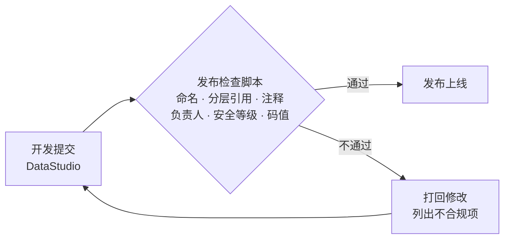

存量表不一次性改名：新表强制执行；存量表按健康分排名分批整改，改名时保留视图兼容下游。

### 1.4.3 元数据与血缘

| 元数据 | 内容 | 来源 |
|---|---|---|
| 技术元数据 | 表结构、字段类型、分区、存储量 | 数据地图自动采集 |
| 业务元数据 | 业务含义、口径、数据域 / 主题域、负责人、安全等级 | 开发填报，治理专员审核 |
| 运行元数据 | 调度依赖、产出时间、运行时长、访问次数 | 运维中心、数据地图 |

血缘打通到最末端，从源表一直到报表、API 和智能体：

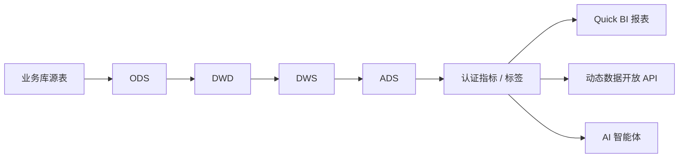

血缘的三个用处：
- **问题定位**：报表数字不对，沿血缘往上查到出错的那一层。
- **影响分析**：改表、改口径前，先查下游有哪些报表、API 受影响，通知到负责人。
- **下线判断**：没有下游、没有访问的表和任务，进入下线清单（见 1.4.8）。

### 1.4.4 主数据

| 主数据 | 统一编码         | 规则 |
|---|--------------|---|
| 景区 | `scenic_id`  | 一个景区一个编码，集团、分园区、子景点分级挂靠 |
| 商品 | `prd_id`     | 票种、套票、二消商品统一编码，挂到景区 |
| 渠道 | `channel_id` | OTA、自营、分销、团队等渠道统一分类 |
| 供应商 | `sup_id`     | 同一主体只建一个编码，多账号挂到同一主体 |
| 游客 | `one_id`     | 手机号、证件号、会员号按规则归并为一人（OneID） |
| 区域 | 行政区划码        | 采用国家标准 |

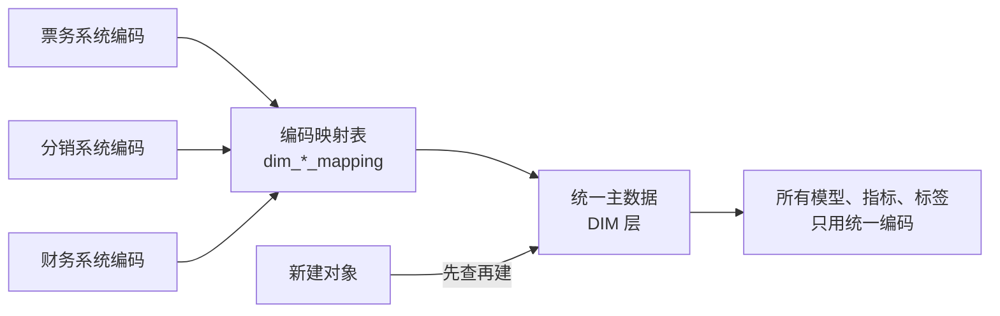

- 新建景区、商品、供应商时先查再建，已存在的直接复用。
- 主数据变更走审批，保留历史（拉链表），保证历史报表可回溯。

### 1.4.5 数据质量

**规则按五个维度建**

| 维度 | 检查什么 | 例子 |
|---|---|---|
| 完整性 | 非空、记录数波动 | 订单号、景区 ID 不能为空；日订单量比近 7 日均值波动超过 30% 告警 |
| 准确性 | 值域、格式、业务逻辑 | 金额不能为负；核销时间不能早于下单时间；手机号格式合法 |
| 一致性 | 跨层、跨系统对账 | DWD 订单金额汇总等于业务库；ADS 核销量等于 DWS |
| 及时性 | 产出时间 | 核心 ADS 每天 7:00 前产出，晚于基线告警 |
| 唯一性 | 主键不重复 | 订单号 + 明细号唯一；同一张票不重复核销 |

**规则分强弱**

| | 强规则 | 弱规则 |
|---|---|---|
| 用在哪 | 核心表：订单、核销、结算、对外 API 的源表 | 一般表 |
| 失败后 | 全局阻断下游，通知负责人 | 只告警，不阻断 |
| 处理时限 | 当天修复 | 一周内修复 |

数据质量模块未购，在重要节点后加质量校验节点实现：任务结束即校验，不通过全局阻断，通知下发。

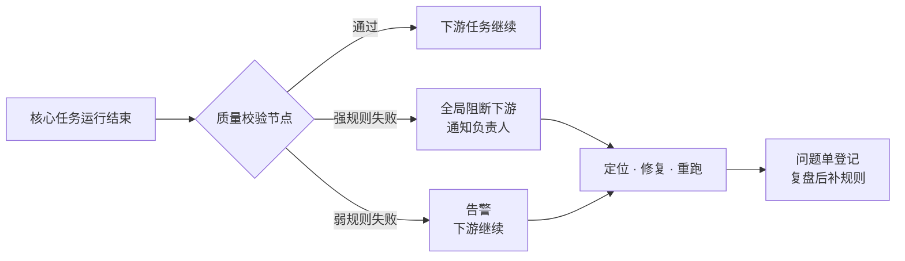

**问题闭环**：发现问题 → 定义规则 → 质量控制（告警 / 阻断）→ 质量评估 → 持续优化。每个问题登记问题单，同类问题出现两次就补规则。

**治理样板：核销逐层核对**。先把四个容易混用的指标分开：核销次数、有效核销票数、入园人次、去重游客数，再按景区 + 日期从源端到出口逐层核对。

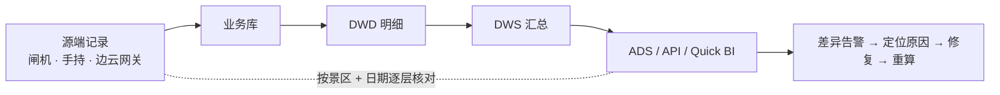

常见差异原因：设备离线补传、重复上报、撤销冲正、按下单时间还是核销时间统计混用。

### 1.4.6 统一指标与标签

**两级体系**：集团统一输出标准指标和标准标签，经过分类分级后下发给景区和供应商；标准不够用时，各景区、供应商在自己的空间里自定义。

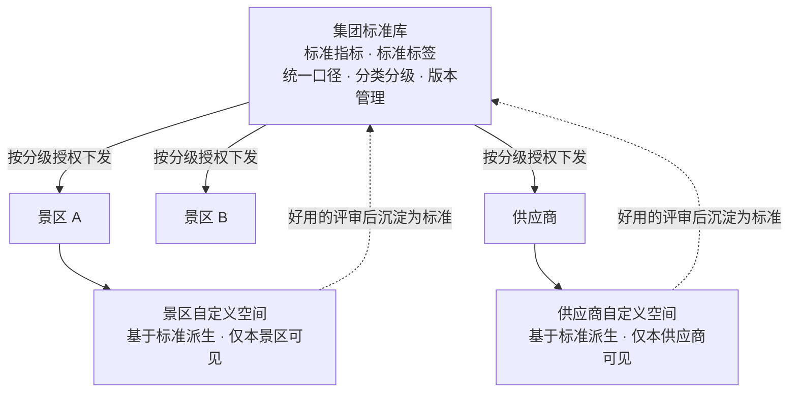

**分类分级**

| | 指标 | 标签 |
|---|---|---|
| 分类 | 交易、核销入园、渠道、结算、会员、业态 | 对象：游客 / 会员、景区、商品、渠道、供应商；类型：基础属性、统计、规则、预测 |
| 分级 | 按开放范围分：集团内部 / 景区可用 / 供应商可用 / 可对外 | 按 L1–L4 安全等级（见 1.4.7）；L4 标签不下发、不对外 |

**标签平台怎么展示和查看**：按“数据域 → 主题域 → 指标 / 标签”三级目录展示，按查看者的角色、租户和安全等级过滤可见内容。

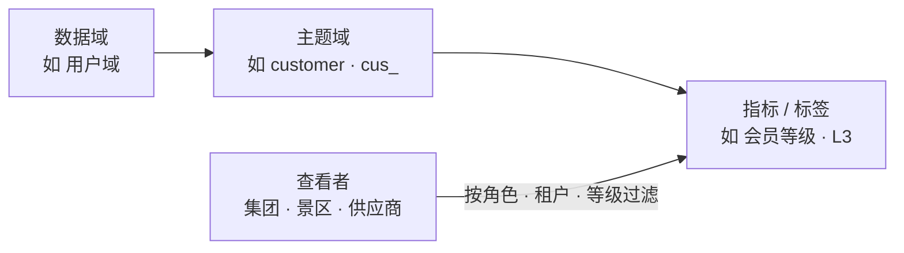

**自定义规则**
- 只能基于集团标准和本主体已授权的数据派生。
- 不能与集团标准同名，不覆盖、不影响其他景区或供应商。
- 只服务本景区或本供应商。
- 使用效果好的自定义指标、标签，评审后升级为集团标准。

**指标怎么定义**：每个指标按“原子指标 + 修饰词 + 时间周期 + 统计粒度”拆开定义。

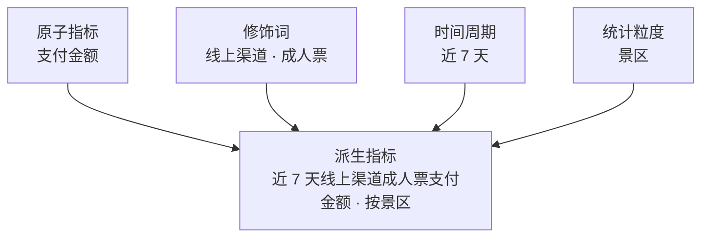

**认证流程**：数据团队起草 → 业务负责人确认 → 治理小组裁定 → 发布并版本化。只有认证过的指标和标签能进入管理层看板、API 和 AI。

### 1.4.7 安全与权限

**数据分级**

| 等级 | 范围 | 管控 |
|---|---|---|
| L4 高敏 | 个人信息（手机号、证件号）、人脸、政务核验结果 | 加密存储、脱敏展示、最小授权、全程审计；明文不进入大模型 |
| L3 敏感 | 单景区经营数据、价格、结算、供应商合作数据 | 按景区 / 供应商隔离；跨主体只看汇总 |
| L2 内部 | 日志、设备状态、运营数据、匿名聚合 | 内部按角色授权 |
| L1 公开 | 已发布的报告、规范 | 可公开 |

**权属边界**

| 数据 | 规则 |
|---|---|
| 景区数据 | 只服务该景区本身 |
| 供应商数据 | 只服务该供应商 |
| 渠道数据 | 不向其他渠道披露 |
| 游客信息 | 在用户授权范围内使用 |
| 政务数据 | 只用核验结果，不留原始数据 |
| 外部采购数据 | 按合同约定范围使用 |
| 对外输出 | 仅限匿名聚合结果 |

**权限模型：角色 × 数据范围 × 字段等级**

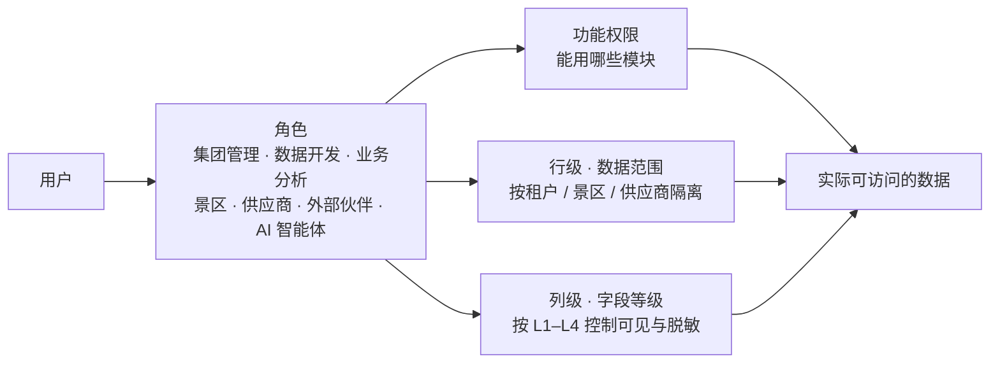

| 角色 | L1 | L2 | L3 | L4 |
|---|---|---|---|---|
| 集团管理层 | 可看 | 可看 | 可看汇总 | 不可看明细 |
| 数据团队 | 可看 | 可看 | 按项目授权 | 审批后脱敏使用 |
| 业务线 | 可看 | 可看 | 本业务线 | 不可看 |
| 景区 | 可看 | 本景区 | 本景区 | 本景区游客，授权后脱敏 |
| 供应商 | 可看 | 本供应商 | 本供应商 | 不可看 |
| 外部伙伴 | 可看 | 不可看 | 仅匿名聚合 | 不可看 |
| AI 智能体 | 继承提问人的权限 | | | |

**权限流程：申请—审批—授权—使用—回收**

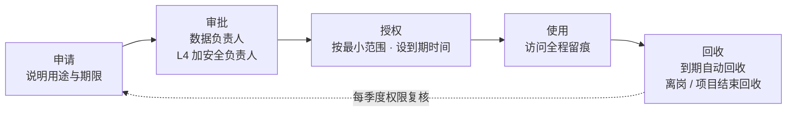

**各出口统一管控**

| 出口 | 管控方式 |
|---|---|
| 湖仓 / DataStudio | 项目、表、字段级授权；开发环境使用脱敏数据 |
| 数据地图 | 可搜索资产目录，按权限申请使用 |
| 动态数据开放 API / 数据服务 | 应用鉴权、租户隔离、字段按等级脱敏、调用审计 |
| Quick BI | 行级权限（按景区 / 供应商）、列级权限 |
| 标签平台 | 按数据域分级查看；L4 标签不下发 |
| AI 智能体 | 继承提问人权限；只调用认证指标和授权数据；L4 明文不进入模型 |

**技术手段**
- 敏感字段自动识别与打标：用 AI 加规则识别证件号、手机号、人脸等字段，由安全负责人复核。
- 脱敏、行列权限、租户隔离、访问留痕。
- 安全中心模块未购：先用计算引擎权限加脱敏视图实现；合规要求提高时评估增购。

### 1.4.8 资产运营

**资产目录**：数据地图按“数据域 → 主题域 → 表 / 指标 / 标签 / API”编目，可搜索、可看口径和血缘、按权限申请使用。

**健康分**：数据资产治理模块按负责人、主题域打分，每月公示排名。

| 维度 | 看什么 |
|---|---|
| 规范 | 命名、注释、负责人、安全等级是否齐全 |
| 质量 | 质量规则覆盖率、通过率、按时产出率 |
| 安全 | 敏感字段是否打标、是否脱敏 |
| 使用 | 访问次数、下游引用数 |
| 成本 | 存储量、计算耗时、重复计算 |

**成本治理与下线**

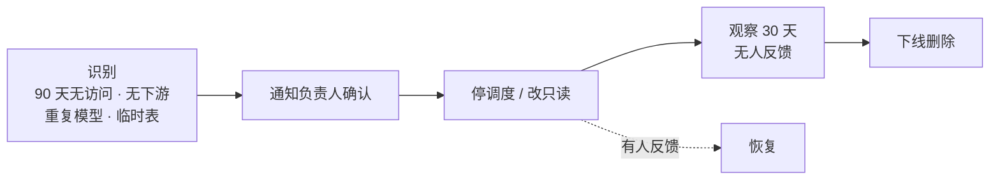

- 临时表设生命周期自动清理；ODS 分区按用途设保留期。
- 重复模型合并到公共层，先双跑对比再切换。

### 1.4.9 数据分发

所有对内对外的数据都从统一出口走，不再点对点导数、私接数据库。动态数据开放 API 作为统一出口，同时提供 ADS 指标和标签服务，两者可以联合使用。

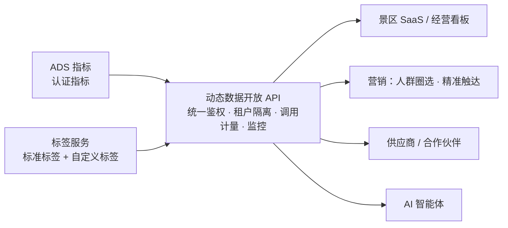

| 用法 | 例子 |
|---|---|
| 只查指标 | 景区经营看板：销售额、核销量、入园人次 |
| 指标 + 标签联合 | 按会员等级看复购率；按游客偏好看各票种销量 |
| 标签圈人 + 指标评估 | 圈选“近 90 天未复购的年卡用户”推送活动，活动后用指标看转化 |
| 只查标签 | 智能体按游客标签做个性化推荐 |

### 1.4.10 治理嵌入研发

治理卡点放进研发的每一步，不另起流程：

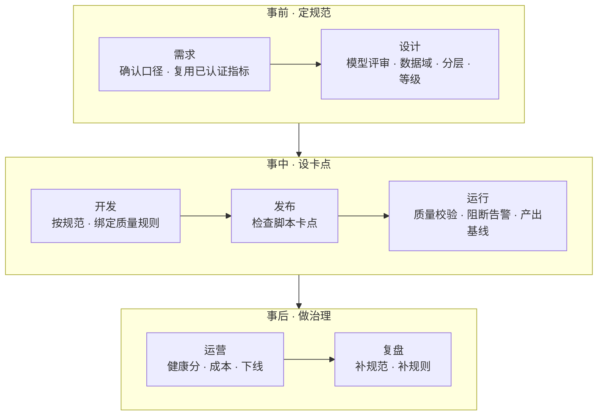

| 阶段 | 事前 · 定规范 | 事中 · 设卡点 | 事后 · 做治理 |
|---|---|---|---|
| 做什么 | 命名规范、指标定义、模型评审 | 发布自动检查、质量规则绑定任务、失败阻断下游 | 健康分公示、存量整改、问题复盘 |
| 谁来做 | 数据架构师、治理专员 | 平台自动执行 | 数据负责人、治理专员 |
| 不做到会怎样 | 模型不能进入开发 | 不能发布；下游不运行 | 健康分低的负责人排名公示，限期整改 |

### 1.4.11 治理组织

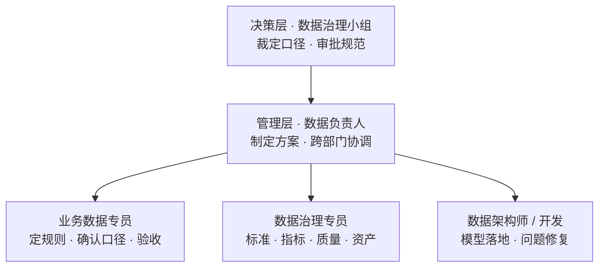

机制：两周一次口径评审，每月公示健康分，每季度复盘。

| 角色 | 职责 |
|---|---|
| 数据治理小组 | 裁定口径争议，审批规范和指标认证 |
| 数据负责人 | 制定治理方案，跨部门协调，对健康分负责 |
| 业务数据专员（各业务线一名） | 提业务规则，确认口径，验收数据 |
| 数据治理专员 | 维护标准、指标字典、质量规则、资产目录 |
| 数据架构师 / 开发 | 模型设计评审，规范落地，问题修复 |

### 1.4.12 治理度量

| 领域 | 指标 | 建议目标（试点链路） |
|---|---|---|
| 数据标准 | 新表规范符合率 | 100% |
| 元数据 | 核心表注释、负责人覆盖率 | 100% |
| 主数据 | 景区、商品、渠道编码映射覆盖率 | 100% |
| 数据质量 | 核心表强规则覆盖率；核心 ADS 按时产出率 | 100%；≥ 99% |
| 指标 | 管理层看板中认证指标占比 | 100% |
| 安全 | 敏感字段识别打标覆盖率 | 100% |
| 资产 | 无用表、无用任务下线 | 每季度清理一轮 |
| 一致性 | 核销量各出口差异 | 0 差异，或差异有原因说明 |

## 1.5 建设路径

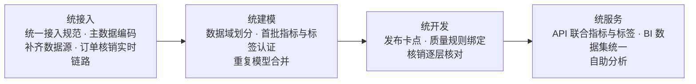

- 先在“订单 → 核销 → 结算”试点，做通后推广到其他数据域。
- 存量模型先双跑对比再切换，保留回滚。

## 1.6 落地效果

**对企业**

| 方面 | 变化 | 衡量 |
|---|---|---|
| 可信 | 一个指标一个口径，数字可追溯 | 认证指标覆盖率、对账差异率 |
| 时效 | 订单、核销从 T+1 到分钟级 | 端到端延迟 |
| 效率 | 优先复用公共模型，改动影响可预判 | 模型复用率、需求交付周期 |
| 成本 | 重复模型、无用报表和任务下线 | 存储计算成本 |
| 安全 | 敏感数据分级、脱敏、可审计 | 敏感字段识别覆盖率 |

**对业务线**

| 业务线 | 治理后的变化 |
|---|---|
| 票务 | 核销口径统一，差异自动定位；节假日实时看数 |
| 财务 | 业务与财务逐层对账，差异自动列出原因 |
| 渠道 | 渠道销量、佣金、返利口径统一 |
| 运营 / 客户成功 | 景区经营报告自动生成 |
| 景区 / 供应商 | 直接用集团标准指标和标签；不够用时在自己的空间里自定义 |
| 营销 | 用标签圈人、用指标看效果，活动复盘自动完成 |
| 产品研发 | 上线前定好埋点和口径，上线即有数据 |
| 管理层 | 驾驶舱全部用认证指标，不再先对数 |
| 数据团队 | 从临时取数、对数转向建模型、做分析 |

**为第二章打基础**：治理后的指标、标签、知识可信、有口径、有权限，AI 接上它们才能答得准。

---

# 二、AI 智能体平台

（待写，按大纲第二章展开）

---

# 三、AI＋数据平台联合

（待写，按大纲第三章展开）

---

## 参考资料

第一章参考：`参考资料/数据治理/` 下 5 篇文章（OneData 方法论与四步建设路径、数据治理操作指南、数据治理定义、数据治理方法与流程、数据仓库 / 湖 / 湖仓区别）。
