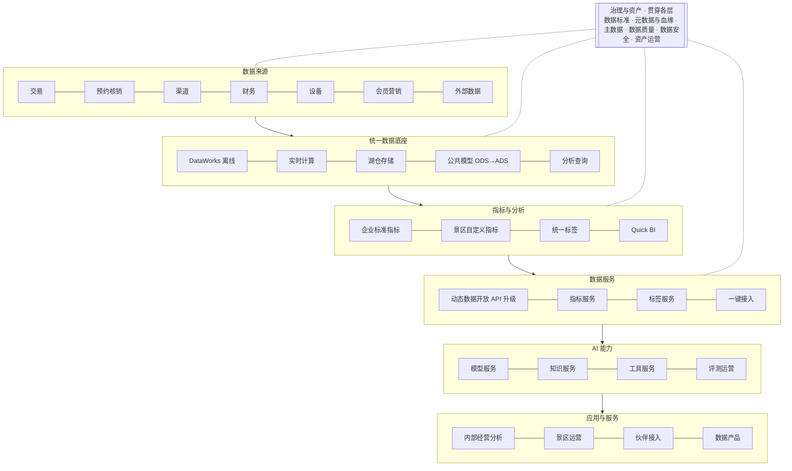

# AI＋数据平台建设汇报（正文）

> 本稿按《AI＋数据平台汇报大纲》展开，分三章：一、数据平台；二、AI 智能体平台；三、AI＋数据平台联合。
> 当前进度：**第一章已完成**，第二、三章待写。

---

# 一、数据平台

## 1.1 现状

**已有工具（全部保留，在此基础上升级）**

| 工具 | 用途 | 现状 |
|---|---|---|
| DataWorks | 离线数据开发、调度、运维、数据服务、资产管理 | 已购模块：DataStudio（数据开发）、运维中心、数据地图、数据资产治理、数据服务；未购：数据质量、数据标准、安全中心 |
| 动态数据开放 API | 把 ADS 层指标以接口形式对内、对外提供 | 可快速发布指标；未与统一指标口径绑定，权限、监控、计量不完善 |
| Quick BI | 报表与分析展示 | 在用；数据集来源分散，报表重复，口径不统一 |
| 湖仓 | 部分模型在湖仓建设 | 与离线模型存在重复开发 |

**已建成**
- 离线主流程已贯通：供应商 / 游客 / 会员 → 订单 → 维度。
- 分层完整：ODS（贴源）→ DWD（明细）→ DIM（维度）→ DWS（汇总）→ ADS（应用）。
- 意义：数仓骨架已经有了，后续是在骨架上“补”和“管”，不需要推倒重来。

**尚未建设**
- 实时数据：没有实时链路，订单、核销等关键数据只有 T+1。
- 数据质量：没有系统化的质量规则和逐层核对。
- 统一标签：标签在各需求中临时加工，口径不一。
- 指标口径管理：没有企业级指标字典和认证流程。
- 数据标准与元数据：规范停留在文档层面，没有在开发流程中强制执行。

## 1.2 问题（例举）

| 问题 | 典型表现 | 影响 | 根因 |
|---|---|---|---|
| 数据孤岛 | 要做一份“景区售票 + 二次消费 + 结算”的综合分析，需要从 3 个以上系统导数，再手工拼表 | 一份综合报表要排期数天；手工拼接容易出错 | 没有统一接入；景区、商品、渠道、游客在各系统的编码不一致 |
| 口径不一 | 同一景区同一天，“核销量”在运营看板、财务对账、对外 API 三处数字不同；“销售额”有的含退款、有的不含 | 开会先对数；业务对数据失去信任 | 没有企业级指标定义；各报表各自写口径 |
| 规范缺失 | 表名随意（如 `tmp_xxx_new2`），字段无注释，DDL 没有负责人和生命周期 | 新人看不懂，老人说不清；改一张表不知道影响谁 | 规范只在文档里，开发上线没有卡点 |
| 模型重复 | 订单宽表在离线、湖仓各有一份，逻辑相近但结果不同 | 同一逻辑维护两遍；口径一改要改多处 | 没有统一公共层，没有“先查后建”的机制 |
| 数字不准 | 入园、核销数与源端记录对不上；节假日差异尤其明显 | 影响结算、对客户的数据交付、管理决策 | 离线补传、重复上报、撤销冲正、发生时间与上报时间混用、缺少逐层核对（需逐项排查确认） |
| 缺少实时 | 节假日客流高峰时，订单、核销、入园数据只能第二天看到；景区容量预警、渠道异常都要靠人工发现 | 高峰期无法实时调度和止损；问题发现滞后，事后才能复盘 | 只有离线 T+1 链路，没有实时采集和实时计算 |

**结论**：
- 前五类问题看起来分散，根因是同一个：缺少统一的标准、模型、口径和校验。单点修补会反复出现，必须体系化治理。
- 第六类是能力缺口：需要在统一的公共模型上补实时链路，避免实时、离线各算一套。

## 1.3 我们有哪些数据

### 1.3.1 数据资产全景

数据资产分两部分：一条交易主链和八类支撑数据。

**交易主链（核心资产）**

| 数据域 | 主要内容 | 主要来源 | 当前状态 |
|---|---|---|---|
| 主体与组织 | 租户、景区、供应商、门店 | 业务系统基础数据 | 已入仓（主流程） |
| 资源与商品 | 票种、库存、价格、时段 | 售票、预约系统 | 部分入仓 |
| 渠道与供销 | 渠道、分销关系、佣金、返利 | 分销系统 | 部分入仓 |
| 订单交易 | 订单、支付、退改 | 交易系统 | 已入仓（主流程） |
| 预约与核销 | 票券、核销、入园通行 | 检票系统、闸机、手持终端 | 部分入仓 |
| 结算与财务 | 清分、对账、发票 | 财务系统 | 部分入仓 |

**支撑数据（八类）**

| 数据类别 | 主要内容 | 当前状态 |
|---|---|---|
| 游客与会员 | 会员、年卡、积分、标签 | 会员已入仓；年卡、积分部分入仓；标签未统一 |
| 营销与增长 | 活动、优惠券、投放 | 部分入仓 |
| 多业态消费 | 餐饮、住宿、停车等二次消费 | 部分入仓 |
| 现场设备 | 闸机、终端状态与事件 | 部分入仓 |
| SaaS 客户 | 景区客户的订阅、使用、工单 | 部分入仓 |
| 平台运行 | 日志、性能、成本 | 部分入仓 |
| 外部与公共 | 天气、地理位置、舆情 | 部分入仓 |
| 知识与 AI | 文档、问答记录、评测数据 | 部分入仓 |

> 说明：除主流程覆盖的主体、订单、会员外，其余数据域目前均为部分入仓，需按 1.4.8 的路径逐域补齐。

### 1.3.2 数据特点

- **难点不在数据量**，而在几个特殊场景：
  - 节假日高峰：短时间流量集中；
  - 订单状态多次变更：支付、改签、退款、核销；
  - 现场设备离线补传：数据迟到、重复；
  - 多租户隔离：不同景区之间数据不能互看。
- 这几点决定了数据平台的设计重点：
  - 增量与变更处理；
  - 迟到数据处理；
  - 租户级权限隔离；
  - 高峰期稳定性。

## 1.4 怎么治理和建设

### 1.4.1 建设思路

参考成熟的数据中台方法论（阿里 OneData），用一句话概括：**统一标准、治理嵌入研发、先试点后推广。**

1. **统一标准**：统一指标定义、统一数据域划分、统一模型规范，消除“同名不同义、同义不同算”。
2. **治理嵌入研发**：治理不在数据生产完成后再补，而是把标准、质量规则、安全策略嵌进开发流程。不符合规范的模型不能上线，质量不过关的数据不能往下游流。
3. **先试点后推广**：先选 1 至 2 个代表性场景做通，形成标准方法和资产清单，再扩展到其他数据域。我们的试点建议选“订单 → 核销 → 结算”这条链路。

### 1.4.2 总体架构：六层分层建设，治理贯穿始终

| 层级 | 作用 | 已有 | 新建或升级 |
|---|---|---|---|
| 数据来源 | 各业务系统产生的原始数据 | — | 统一接入规范与对象编码 |
| 统一数据底座 | 一份存储、一套公共模型，离线与实时两种计算方式 | DataWorks、离线主流程 | 实时计算、湖仓统一、公共层整合 |
| 指标与分析 | 统一口径的指标、标签和分析入口 | Quick BI | 指标字典、景区自定义指标、统一标签 |
| 数据服务 | 对内对外统一数据出口 | 动态数据开放 API | 关联标准指标、权限、监控、计量、一键接入 |
| AI 能力 | 让 AI 通过可信数据作答（详见第二章） | — | 新建 |
| 应用与服务 | 内部经营、景区运营、伙伴接入、数据产品 | 部分 | 按需建设 |
| 治理与资产（贯穿） | 标准、元数据、主数据、质量、安全、资产运营 | — | 新建，嵌入各层 |

### 1.4.3 平台组件：七组能力，在已有工具上升级与新建

| 能力组 | 已有（直接用） | 升级（在已有基础上增强） | 新建 |
|---|---|---|---|
| 数据集成 | 批量同步（DataWorks） | 埋点采集、边云回传 | 实时采集、标准连接器 |
| 存储计算 | 离线计算 | — | 实时计算、湖仓统一存储、分析引擎 |
| 开发运维 | 开发调度（DataWorks） | 数据建模、运行监控 | 发布卡点、成本治理 |
| 数据治理 | — | 数据地图、数据血缘 | 数据标准、质量与核对、分级与脱敏、资产运营 |
| 指标标签 | — | — | 指标中心、景区指标空间、标签平台、统一语义层 |
| 服务分析 | 动态数据开放 API、Quick BI | — | 开发者门户、嵌入式分析 |
| AI 能力 | — | AI 问数 | 模型网关、知识检索、智能体工具、评测反馈 |

> **DataWorks 模块使用规划**
>
> | 模块 | 状态 | 用途 |
> |---|---|---|
> | DataStudio（数据开发） | 已购 | 离线开发、建模、发布 |
> | 运维中心 | 已购 | 调度、监控、告警、补数 |
> | 数据地图 | 已购 | 资产目录、元数据、血缘、影响分析 |
> | 数据资产治理 | 已购 | 治理健康分、治理项（规范、成本、无用资产）、治理计划 |
> | 数据服务 | 已购 | 把模型和指标封装为 API，与动态数据开放 API 统一规划为数据出口 |
> | 数据质量 | 未购 | 二选一：增购（规则配置、强规则阻断，推荐）；或在 DataStudio 中写校验任务，由运维中心告警（成本低，维护量大） |
> | 数据标准 | 未购 | 先用规范文档 + 发布前检查脚本落地；数据量和团队规模上来后再评估增购 |
> | 安全中心 | 未购 | 先用计算引擎层权限 + 脱敏视图管控敏感数据；涉及个人信息合规要求时评估增购 |
> | 实时计算 | 未购 | 需新增实时计算与实时存储组件（如实时计算 Flink 版 + Hologres），先做 POC |

### 1.4.4 治理体系：六项内容

| 治理内容 | 要解决的问题 | 具体做法 | 落地工具 |
|---|---|---|---|
| 数据标准 | 同一个字段、同一个码值，各系统含义不同 | 统一字段标准、码值标准（如景区类型、票种类型、渠道类型）、词根库与命名规范 | 规范文档 + 发布前检查脚本（数据标准模块未购，后续评估） |
| 元数据与血缘 | 不知道有哪些数据、在哪里、谁负责、改了影响谁 | 采集技术元数据（表、字段、任务），补齐业务元数据（业务含义、负责人、口径）；打通“源表 → 模型 → 指标 → 报表 / API”的血缘 | DataWorks 数据地图（已购） |
| 主数据 | 景区、商品、渠道、供应商、游客在各系统编码不同，关联不上 | 确定每类主数据的唯一来源和统一编码；源头录入时“先查再建”，避免重复创建 | 主数据清单 + 编码规则 |
| 数据质量 | 数字不准、不及时、对不上 | 按完整性、准确性、一致性、及时性配置质量规则；关键规则失败时阻断下游；逐层核对 | DataWorks 数据质量（未购，建议增购）；或 DataStudio 校验任务 + 运维中心告警 |
| 数据安全 | 敏感数据泄露、越权访问 | 分类分级、敏感字段识别与脱敏、字段级权限；“申请—审批—授权—使用—回收”闭环；访问审计 | 计算引擎权限 + 脱敏视图（安全中心未购，按合规要求评估） |
| 数据资产运营 | 数据建了没人用、用了不知道价值 | 资产目录、资产健康分、使用情况统计、长期无人使用的资产下线 | DataWorks 数据资产治理（已购） |

### 1.4.5 治理嵌入研发：事前、事中、事后三道关

| 环节 | 做什么 | 例子 |
|---|---|---|
| 事前：定规范 | 发布开发规范、指标定义模板、数据标准；新模型设计要评审 | 表名必须按 `层级_主题域_业务过程_粒度_更新方式`，如 `dwd_trd_order_item_di` |
| 事中：设卡点 | 上线前自动检查命名、注释、负责人、安全等级；质量规则与任务绑定，强规则失败自动阻断下游 | “核销次数 < 有效核销票数”触发强规则，下游汇总任务不运行，错误数字不进入看板 |
| 事后：做治理 | 资产健康分月度公示；存量问题按优先级整改；质量问题复盘 | 每月公布各数据域的健康分和整改进度 |

**数据质量的处理流程**：发现问题 → 定义规则 → 质量控制（告警或阻断） → 质量评估 → 持续优化。

**数据质量的衡量**：从五个方面定期打分，每月形成质量报告。
- 数据完整性；
- 监控覆盖程度；
- 告警响应速度；
- 作业稳定性；
- 作业时效性。

### 1.4.6 以核销为样板：逐层核对

核销是出错代价最大、各方最关心的数据，作为第一个治理样板。

**第一步：先把四个容易混用的指标分开定义**

| 指标 | 定义（草案） | 常见混用 |
|---|---|---|
| 核销次数 | 按核销发生时间统计，扣除撤销 | 与入园人次混用 |
| 有效核销票数 | 至少成功核销一次的票 | 与核销次数混用（一票多次核销） |
| 入园人次 | 闸机 / 人脸通行次数 | 与核销次数混用（一码多人、团队票） |
| 去重游客数 | 按游客身份去重 | 与入园人次混用 |

**第二步：逐层核对**

源端记录 → 业务库 → DWD 明细 → DWS 汇总 → ADS / API / Quick BI

- 每一层按“景区 + 日期”核对条数和金额，差异超过阈值即告警并生成问题工单。
- 差异按原因归类：离线补传、重复上报、撤销冲正、时间口径、ID 映射、景区个性规则。

**第三步：透明**

- 看板和 API 标注“数据更新时间”和“质量状态”，让使用者知道数据可不可以用。

### 1.4.7 指标口径统一

参照 OneData 的指标拆分方式，每个指标按“原子指标 + 修饰词 + 时间周期 + 统计粒度”拆开定义。

| 组成 | 含义 | 例子 |
|---|---|---|
| 原子指标 | 不可再拆的业务度量 | 支付金额、核销次数 |
| 修饰词 | 业务限定条件 | 线上渠道、成人票 |
| 时间周期 | 统计的时间范围 | 当日、近 7 天、本月 |
| 统计粒度 | 按什么维度汇总 | 景区、渠道、票种 |
| 派生指标 | 以上组合 | 近 7 天线上渠道成人票支付金额（按景区） |

**指标认证流程**：数据团队起草 → 业务负责人确认 → 争议提交治理小组裁定 → 发布并版本化。

**使用规则**
- 只有认证指标能进入管理层看板、对外 API 和 AI 问数。
- 景区个性需求可以在“景区自定义指标空间”中定义，但不能与企业标准指标同名。

### 1.4.8 建设路径：四步走

| 步骤 | 目标 | 关键动作 | 交付物 | 验收标准 |
|---|---|---|---|---|
| 统接入 | 打通数据孤岛 | 统一接入规范；主数据统一编码；补齐核销、渠道、结算等数据源；订单、核销实时链路 POC 并上线 | 数据资源清单、接入规范、主数据清单、实时链路 | 核心数据源全部纳入统一调度和监控；订单、核销分钟级可见 |
| 统建模 | 消除口径二义性 | 数据域划分；首批核心指标认证；离线与湖仓重复模型盘点与合并 | 数据域规划、指标字典、公共层模型 | 首批核心指标认证完成；重复模型有合并计划 |
| 统开发 | 治理嵌入研发 | 发布卡点；质量规则与任务绑定；核销逐层核对上线 | 开发规范、卡点规则、质量规则集 | 新建表规范通过率 100%；关键规则可阻断 |
| 统服务 | 数据主动服务业务 | 动态数据开放 API 关联标准指标；Quick BI 数据集统一；自助分析 | 指标服务、统一数据集、自助模板 | 核心看板 100% 走认证指标；自助取数比例提升 |

**推进原则**
- 先选“订单 → 核销 → 结算”试点，做通后形成方法和模板，再推广到其他数据域。
- 存量不动、增量按新规范；改动存量模型时，先双跑对比，再切换，并保留回滚方案。

### 1.4.9 湖仓选型说明

| 形态 | 适合 | 我们的用法 |
|---|---|---|
| 数据仓库 | 结构化、口径明确的报表与分析 | 公共模型与指标，继续以离线数仓为主 |
| 数据湖 | 原始数据、半结构化日志、设备数据、AI 训练语料 | 设备日志、行为日志、知识文档 |
| 湖仓一体 | 兼顾湖的灵活和仓的规范 | 统一存储，离线与实时共用一套公共模型，解决“离线、湖仓两套模型”的重复问题 |

### 1.4.10 组织保障

| 层级 | 角色 | 职责 |
|---|---|---|
| 决策层 | 数据治理小组（管理层牵头） | 拍板口径争议；审批规范和治理计划；季度复盘 |
| 管理层 | 数据负责人、项目经理 | 制定治理方案与计划；跨部门协调；推动落地 |
| 执行层 | 业务数据专员 | 每条业务线 1 人：定义业务规则、确认指标口径、验收数据 |
| 执行层 | 数据治理专员 | 维护数据标准、指标字典、质量监控、资产运营 |
| 执行层 | 数据架构师 / 开发 | 标准落地、模型落地、质量问题修复 |

> 执行层的“业务数据专员 + 数据治理专员 + 数据架构师”形成铁三角，每个数据域都要明确这三个角色。

**工作机制**
- 每两周：口径评审会。
- 每月：资产健康分公示、质量报告。
- 每季度：治理小组复盘。

## 1.5 建成后的效果

### 1.5.1 对企业

| 方面 | 变化 | 衡量指标（建议） |
|---|---|---|
| 数据可信 | 同一指标全公司一个口径、一个数字；关键数字可以追溯到源头 | 核心指标认证覆盖率；核销对账差异率 |
| 数据时效 | 订单、核销从 T+1 变为分钟级，高峰期可以实时调度和预警 | 关键数据端到端延迟 |
| 研发效率 | 新需求优先复用公共模型，不再重复开发；改动影响可以提前评估 | 公共模型复用率；需求交付周期 |
| 成本 | 重复模型、无用报表、僵尸任务下线，存储和计算成本下降 | 重复模型下线数量；存储计算成本 |
| 风险 | 敏感数据有分级、有脱敏、有审计；错误数据被阻断在下游之前 | 敏感字段识别覆盖率；强规则拦截次数 |
| 资产化 | 数据有目录、有负责人、有健康分，可盘点、可评估 | 资产目录覆盖率；资产健康分 |

### 1.5.2 对业务线

| 业务线 | 现在 | 治理后 | 衡量指标（建议） |
|---|---|---|---|
| 票务 | 核销、入园数各处不一致，节假日对数耗时 | 四个核销指标口径统一，差异自动定位到环节；订单、核销实时可见 | 核销对账差异率；对数耗时 |
| 财务 | 结算与业务数据对不上，逐笔人工查 | 业务与财务逐层核对，差异自动列出并给出原因 | 差异定位时长；月结耗时 |
| 渠道 | 各渠道销量、佣金、返利口径不一 | 渠道指标统一认证，渠道效果看板 | 渠道数据核对差异 |
| 运营 / 客户成功 | 给景区出经营报告靠手工拼表 | 标准分析模板，报告自动生成 | 报告人工耗时 |
| 产品研发 | 新功能上线后才发现缺数据、口径不清 | 上线前按规范定义埋点和口径，上线即有数据 | 新功能数据就绪时间 |
| 管理层 | 开会先对数，数字不敢用 | 驾驶舱指标全部来自认证口径，异常自动推送 | 驾驶舱认证指标覆盖率 |
| 数据团队 | 大量时间在临时取数、对数、救火 | 转向建模型、出指标、做分析 | 临时取数需求占比；故障次数 |

### 1.5.3 为 AI 打基础

- 数据治理好之后，指标、标签、知识都是“可信、有口径、有权限”的。
- 这是第二章 AI 智能体平台的前提：AI 只有接上可信数据，才能答得准、用得放心。

---

# 二、AI 智能体平台

（待写，按大纲第二章展开）

---

# 三、AI＋数据平台联合

（待写，按大纲第三章展开）

---

## 参考资料

第一章写作时参考了以下资料（原文存于 `参考资料/数据治理/`）：

1. 《从零到一：企业如何建设数据系统的完整落地指南》
   - 参考点：OneData 方法论、治理嵌入研发、统接入 / 统建模 / 统开发 / 统服务四阶段、试点先行、组织配套。
2. 《【数据治理】数据治理操作指南（完整版）》
   - 参考点：六项治理内容、质量四维度、事前 / 事中 / 事后、决策层 / 管理层 / 执行层、执行层铁三角、质量雷达评估。
3. 百度百科《数据治理》
   - 参考点：元数据管理是治理关键、业务术语统一、主动型治理（源头治理）。
4. 《一篇文章搞懂数据仓库：数据治理（目的、方法、流程）》
   - 参考点：“理、采、存、管、用”五步、质量衡量标准、质量处理流程、API 共享方式。
5. 《一文讲透数据仓库、数据湖、数据海的区别》
   - 参考点：数据仓库、数据湖、湖仓一体的适用场景。
